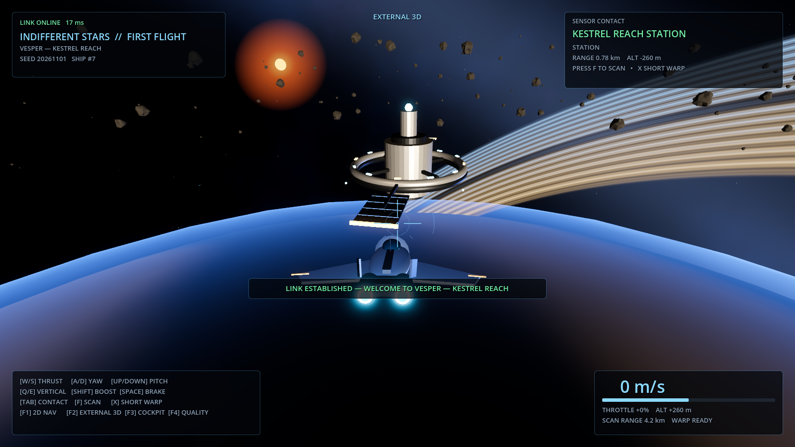
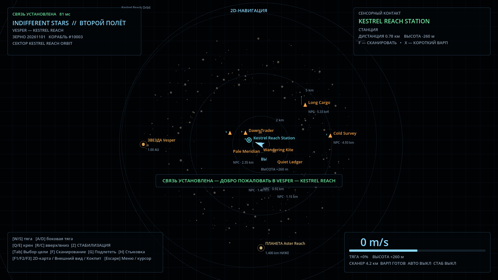
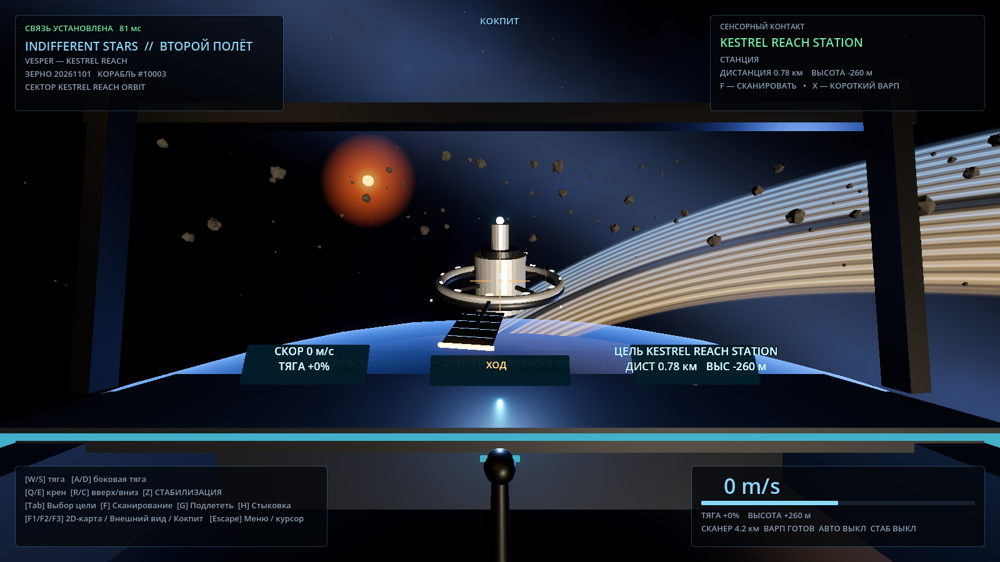
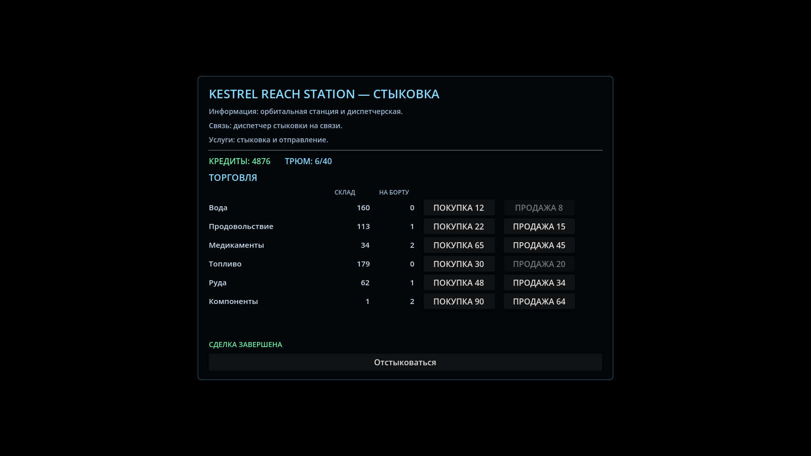

# Indifferent Stars

**A living universe. Beautiful, vast, and indifferent.**

> The universe owes you nothing.

Indifferent Stars — открытая по замыслу космическая песочница с живой галактикой, самостоятельными NPC и возможностью играть одному, с друзьями на своём сервере или на публичном сервере.

Вдохновение: свобода и живая вселенная «Космических рейнджеров», пространственная организация EVE Online. Не клон этих игр.

## Основные принципы

- Космос должен быть прекрасным, пугающим и поражающим масштабом.
- Игрок — один из многих капитанов, а не избранный спаситель вселенной.
- Одна серверная симуляция, три равноправных представления: 2D-навигация, внешняя 3D-камера и кокпит.
- Никаких обязательных переключений представления ради обычных игровых действий.
- Мир продолжает жить и без участия игрока.
- Локальный одиночный сервер и выделенный сервер используют одно ядро; постоянное подключение к внешним сервисам не требуется.

## Что уже работает (Second Flight)

Второй играбельный вертикальный срез — система **Vesper — Kestrel Reach**:

- авторитетный headless-сервер на .NET 10: полёт, 8 NPC по повторяемым маршрутам, снимки состояния 20 раз в секунду;
- клиент Godot 4.7.2 .NET с тремя равноправными видами: `F1` 2D-навигация, `F2` внешняя 3D-камера, `F3` кокпит;
- сканирование и короткий варп с серверной проверкой цели и дистанции;
- второй клиент видит первого и общие NPC;
- масштабная система: звезда Vesper радиусом 696 000 км в 1 а.е. от планеты Aster Reach радиусом 7 450 км с кольцами и атмосферой; станция на орбите в 1 400 км над поверхностью;
- серверная торговля на станции: шесть товаров, кредиты, трюм на 40 единиц, склад станции и локализованные отказы;
- два смежных сектора в одной локальной системе координат (`Kestrel Reach Orbit` и `Kestrel Reach Belt`) с дистанционным интересом: сервер отправляет каждому клиенту только релевантные корабли;
- живой кокпит: скорость, тяга, режим, цель, дистанция и высота выводятся на приборы прямо в 3D-кабине;
- выхлоп двигателей и шлейфы, масштабируемые тягой и форсажем;
- полная локализация интерфейса, HUD, торговли и серверных сообщений на русский и английский.

### Как это выглядит

| Внешняя 3D-камера | 2D-навигация | Кокпит |
| --- | --- | --- |
|  |  |  |



## Требования

- Linux (проверено на Debian 13), .NET SDK 10, Godot 4.7.2 **.NET / Mono**.
- GPU с Vulkan (проверено на Radeon RX 580 8 GB, Forward+).
- Для скачивания движка и первого восстановления NuGet-пакетов нужен интернет. После подготовки локальная игра работает без интернета, PostgreSQL/Docker/аккаунтов; обычная сборка и запуск не требуют `sudo`.

Установка нужной редакции Godot для Linux x86_64 в домашний каталог:

```bash
tools/install-godot-dotnet.sh
```

Скрипт скачивает официальный Godot 4.7.2 **.NET**, проверяет SHA-256 и сохраняет весь комплект вместе с `GodotSharp` в `~/.local/opt/godot-dotnet/4.7.2`. Команда `~/.local/bin/godot-dotnet` — ссылка на установленный движок. Обычный Godot и настройки оболочки не изменяются. Для другого каталога доступен `--prefix /path/to/prefix`. Нужны `curl`, `unzip`, `sha256sum`; .NET SDK 10 устанавливается отдельно. Источник: [официальные загрузки Godot](https://godotengine.org/download/linux/), вариант «.NET».

Проверка версии:

```bash
~/.local/bin/godot-dotnet --version
# 4.7.2.stable.mono.official.…
```

Если `godot-dotnet` не в `PATH`, передайте путь явно:

```bash
export GODOT_BIN="$HOME/.local/bin/godot-dotnet"
```

## Запуск

Из корня репозитория.

Клиент открывает главное меню. В настройках можно выбрать русский или английский язык
меню, адрес сервера, позывной, клавиши, мышь, уровни звука и параметры изображения.
Настройки сохраняются в `user://settings.cfg`. Во время полёта `Esc` сначала освобождает
курсор, повторное нажатие открывает меню; серверная симуляция при этом не останавливается.

### 1. Сервер

```bash
dotnet run --project src/IndifferentStars.Server
```

или

```bash
tools/run-server.sh
```

Сервер слушает UDP `0.0.0.0:7777` и печатает строку `Listening on udp ...`.
Опции: `--port`, `--bind`, `--seed`, `--tick-rate`, `--snapshot-rate`, `--max-players`.

### 2. Клиент

```bash
tools/run-client.sh
```

или, если бинарник называется иначе:

```bash
GODOT_BIN="$HOME/.local/bin/godot-dotnet" tools/run-client.sh
```

Аргументы клиента передаются скрипту напрямую:

```bash
tools/run-client.sh --name Nova --server 127.0.0.1:7777 --view 3d
```

`--view 2d|3d|cockpit` задаёт стартовое представление, `--quality low` отключает bloom.
`--capture <каталог>` сохраняет три скриншота представлений и завершает клиент — это
используется для проверки интерфейса и документации.

### 3. Второй клиент

Запустите ещё один экземпляр с другим позывным:

```bash
tools/run-client.sh --name Vega
```

Оба клиента должны оказаться в одной системе, видеть друг друга и одни и те же NPC.

### 4. Сервер и клиент одной командой

```bash
tools/run-local.sh --name Nova
```

Скрипт собирает сервер, ждёт готовности порта, запускает клиент и останавливает сервер при выходе. Клиентский скрипт проверяет версию и поддержку C#, собирает C#-проект и проверяет готовность ресурсов. На свежем клоне или после изменений выполняется headless-импорт; проверенный кэш позволяет запускать игру без редактора. `IS_PORT` меняет порт, `IS_RESOLUTION` — разрешение окна.
Если UDP-порт занят, сервер сообщает об этом и не завершает чужой процесс. Можно
подключить клиент к работающему серверу либо выбрать другой порт, например
`IS_PORT=7778 tools/run-local.sh --name Nova`. Путь к журналу выводится при запуске.

При проверке кэша отдельный процесс движка сверяет исходные и импортированные файлы, параметры импорта, настройки проекта и сборку клиента, загружает модели, музыку, значок и основную сцену и проверяет доступность C#-класса. Результат хранится в `.godot/client_resources.sha256`.

Для наблюдавшегося сбоя Godot 4.7.2 при завершении импортера (`is_cmdline_mode`, null singleton, SIGSEGV, код 134/139) предусмотрен ограниченный обход: продолжение разрешается только после завершённого импорта и успешной независимой проверки ресурсов в режиме игрового движка. Скрипт выводит предупреждение и путь к сохранённому журналу. Другие сбои импортера, ошибки ресурсов и неуспешная проверка останавливают запуск. Переустанавливать .NET или Godot из-за этого сбоя не требуется.

### 5. Тесты

```bash
dotnet test tests/IndifferentStars.Tests
tools/tests/check-client-startup.sh
```

## Управление

| Клавиша | Действие |
| --- | --- |
| `W` / `S` | тяга вперёд / назад |
| `A` / `D` | боковая тяга влево / вправо |
| Стрелки / мышь | поворот и тангаж; щелчок в 3D захватывает курсор, `Esc` освобождает |
| `Q` / `E` | крен |
| `R` / `C` | вертикальная тяга вверх / вниз |
| `Shift` | местный форсаж до 720 м/с |
| `V` | крейсерский режим до 20 км/с; повторное нажатие включает торможение |
| `Space` | торможение |
| `Z` | включить / выключить flight assist (гашение бокового и вертикального дрейфа) |
| `Tab` | выбрать следующую цель |
| `F` | сканировать выбранную цель |
| `X` | в крейсерском режиме — дальний варп на 10 км; иначе — короткий на 1 км. Все дистанции доступны в меню 2D |
| `G` | автопилот к выбранному локальному статическому объекту |
| `H` | запросить стыковку с выбранной станцией |
| Правый щелчок по пустому месту 2D | приказ лететь в точку на текущей высоте; маршрут исполняет сервер |
| `M` / `Home` в 2D | обзор системы вокруг звезды / центрировать на корабле |
| Колесо / средняя кнопка мыши в 2D | масштабирование относительно курсора / панорамирование |
| `F1` / `F2` / `F3` | 2D-навигация / внешняя 3D-камера / кокпит |
| `F4` | переключить качество (high/low) |

Все виды показывают один и тот же корабль: переключение представления не меняет позицию, скорость и приказ автопилота. В 2D правой кнопкой можно выбрать ближайший к указателю контакт и открыть меню; ручное управление полётом в 2D отключено. При ручном вводе в 3D автопилот отключается.

### Торговля

Пристыкуйтесь клавишей `H` у станции. Откроется экран станции с балансом, загрузкой трюма
и рынком из шести товаров. Кнопки «Купить»/«Продать» отправляют намерение на сервер;
кредиты, груз и склад станции меняет только сервер. Клиент никогда не подтверждает сделку
локально: он показывает ответ сервера («сделка завершена» или причину отказа). Кнопка
«Отстыковаться» возвращает в полёт. Стартовый баланс — 5 000 кредитов, трюм — 40 единиц.

Сектор, в котором находится корабль, отображается в левом верхнем углу HUD; при пересечении
границы сектора появляется уведомление. В 2D-режиме границы секторов видны как окружности.

## Устройство репозитория

- `client/` — проект Godot .NET: сцены, ввод, HUD, 2D/3D/кокпит, шейдеры, сгенерированные `.glb`.
- `src/IndifferentStars.Shared/` — протокол, DTO, каталог мира, математика; без `Godot.*`.
- `src/IndifferentStars.Simulation/` — авторитетный мир, NPC, полётная модель, правила команд.
- `src/IndifferentStars.Server/` — UDP-сервер и сессии.
- `tests/IndifferentStars.Tests/` — тесты протокола, мира и полёта.
- `tools/art/build_assets.py` — воспроизводимая генерация корабля, станции и астероидов в Blender.
- `docs/media/` — превью сгенерированных моделей.

## Документы

- [AGENTS.md](AGENTS.md) — обязательные правила работы для ИИ-агентов.
- [docs/GAME_DESIGN.md](docs/GAME_DESIGN.md) — концепция и границы проекта.
- [docs/ARCHITECTURE.md](docs/ARCHITECTURE.md) — технические принципы и текущая реализация.
- [docs/tasks/001-foundation.md](docs/tasks/001-foundation.md) — первое задание.
- [docs/tasks/002-second-flight.md](docs/tasks/002-second-flight.md) — Second Flight и уточнения владельца.

## Известные ограничения прототипа

Музыка «The Endless Silence» и «A Speck Among Stars» — Mirivlad; автор разрешил
размещение этих записей в репозитории проекта.

- Полёт аркадный: без тяги и flight assist сохраняется скорость, `Space` включает противотягу; орбитальной механики, гравитации и столкновений нет.
- Секторов пока два, оба в одной локальной системе координат; граница — смена активной области и набора видимых кораблей, а не загрузка сцены. Геометрия астероидных областей подгружается по расстоянию; станция остаётся в сцене. Свободный полёт за 100 км и варп проверены в Godot Forward+ на RX 580.
- Автопилот поддерживает сближение с локальными объектами и следование за кораблями; обход препятствий пока не реализован. Станция поддерживает разрешение, стыковку и отстыковку.
- Торговля работает только на одной станции: цены и склад фиксированы на время жизни сервера, сохранений между запусками нет. Количество покупается и продаётся по одной единице за нажатие.
- К планете можно приближаться обычным полётом; дальний варп к известным телам системы доступен после крейсерского разгона. Гравитация, посадка и столкновения с поверхностью не реализованы.
- Далёкие тела рисуются проекцией: размер планеты меняется по текущей дистанции, звезда художественно увеличена. Физические координаты не меняются.
- Астероиды не разрушаются, экономики, посадок и PvP нет.
- Публичный сервер не защищён: протокол без шифрования и аутентификации, рассчитан на localhost/LAN.
- Интерфейс, HUD, торговля и сообщения сервера локализованы на русский и английский; имена объектов каталога (Vesper, Aster Reach, Kestrel Reach) остаются английскими.

На F1 слева постоянно показаны километры до поверхности Aster Reach и скорость сближения: плюс означает приближение, минус — удаление. Направление носа не заменяет вектор скорости. Стартовая высота около 1400 км: прямой полёт на 260 м/с занимает около 90 минут, на 720 м/с — около 32 минут.

### Крейсерский полёт и дальний варп

Уйдите от ближайших тел и кораблей хотя бы на 10 км (в 2D отдалите карту, нажмите правой кнопкой по пустому месту и выберите «Лететь в эту точку»), затем нажмите `V`: двигатели разгоняют корабль до 20 км/с. При сближении сервер учитывает тормозной путь и включает противотягу. Повторное `V` также тормозит до остановки.

Отказ во включении круиза автоматически снимает запрос и сохраняет обычную тягу: у станции можно продолжать разгон `W` + `Shift`, а после выхода из опасной зоны снова нажать `V`. Если опасная зона обнаружена уже на крейсерской скорости, сервер выполняет защитное торможение до остановки; затем обычное управление снова доступно. Отказ и защитное торможение показаны разными уведомлениями.

После разгона хотя бы до 1 км/с выберите цель и нажмите `X` либо пункт «Дальний варп — 10 км» в 2D. Дальность внутри системы не ограничена прежними 21 км. Для кораблей цель должна оставаться в области сенсорной видимости (15 км); тела каталога системы известны постоянно. Сервер проверяет свободную точку и переносит корабль в 10 км от безопасной границы цели с нулевой скоростью. Для планеты эта граница включает атмосферу, поэтому у Aster Reach остаток до твёрдой поверхности будет 150 км. Старые варианты 500 м / 1 км / 5 км остаются местным варпом. Это текущая мгновенная механика варпа; анимированного перелёта и топлива пока нет.


Ионные следы живут 0,3 с в координатах мира: поворот корпуса и смена начала отображения не поворачивают уже выпущенный след. В настройках отдельно отключаются следы/частицы и все эффекты двигателей. Боковая тяга, вращение и торможение включают отдельные маневровые струи по изменению серверного состояния. Внешняя камера сохраняет расстояние до корабля и на крейсерской скорости. `Tab` включает планету и звезду в перебор целей.

Проверки клиента после `dotnet build client/IndifferentStars.Client.csproj`:

```bash
godot-dotnet --headless --path client res://tests/ShipTrackChecks.tscn
godot-dotnet --headless --path client res://tests/NavigationChecks.tscn
godot-dotnet --headless --path client res://tests/EffectsChecks.tscn
```

Полный графический прогон занимает около минуты и требует отдельного локального сервера:

```bash
# Первый терминал
dotnet run --project src/IndifferentStars.Server -- --port 7793
# Второй терминал (изолированные настройки тестового клиента)
XDG_DATA_HOME=$(mktemp -d) IS_FLIGHT_CAPTURE=/tmp/indifferent-flight-checks \
  godot-dotnet --path client --resolution 960x540 res://tests/FlightChecks.tscn -- --server 127.0.0.1:7793
```

Сцена сама подаёт ввод, проверяет крейсерский разгон, переключение видов, варп, манёвры, торможение и сохраняет снимки. Сервер из первого терминала завершите `Ctrl+C`. Диагностика слоёв планеты: `godot-dotnet --path client res://tests/EffectsChecks.tscn -- /tmp/indifferent-planet-layers` сохраняет полный кадр и варианты без bloom, колец и атмосферы.

Клиент и сервер используют протокол v11; после обновления необходимо перезапустить обе стороны. Приказ полёта в точку задаёт цель, а не позицию корабля: сервер проверяет координаты и ведёт корабль обычными двигателями. По завершении он тормозит; ручной ввод или включение крейсерского режима отменяют маршрут. На карте показаны линия и маркер конечной точки. Обход препятствий этим приказом пока не выполняется.


В `F1` позиции на карте имеют единый масштаб; внизу показана масштабная линейка. Направления на планету и звезду вынесены в отдельную панель с расстояниями: их стрелки не обозначают позиции на координатной карте. Строки панели позволяют выбрать тело и открыть его контекстное меню. На планетарном масштабе показаны проекции планеты и границ колец в XZ, относительная высота указана отдельно. В обзоре системы (`M`) корабль в сотнях километров от планеты находится рядом с её значком, а звезда — примерно в 1 а.е. Размеры значков в этом обзоре увеличены для читаемости.

Проверка согласованности карты и 3D на позиции с высотой −4170,926 км и расстоянием 719,3 км до поверхности:

```bash
godot-dotnet --path client --resolution 1600x900 res://tests/NavigationChecks.tscn -- /tmp/indifferent-navigation
```

Сцена проверяет физические расстояния, выбор тел в панели, местный и системный масштабы, затем сохраняет три карты, внешний вид и кокпит из одной позиции.
