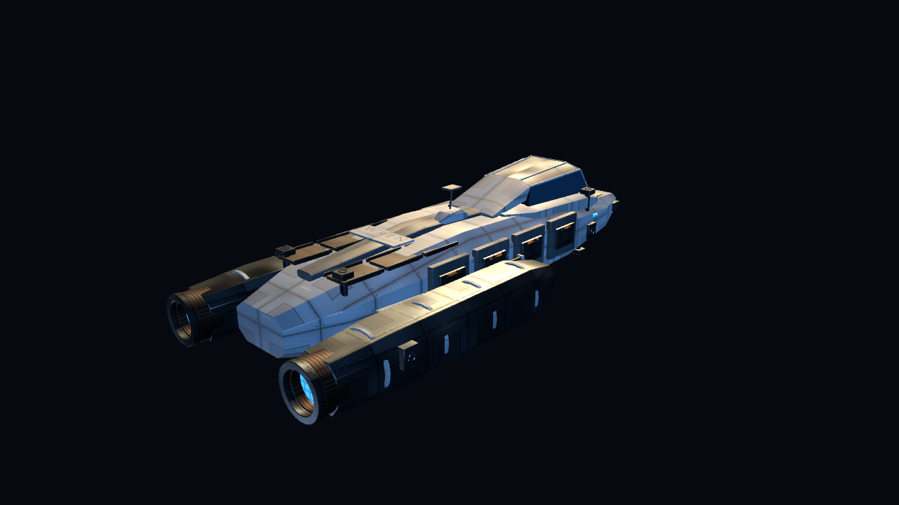
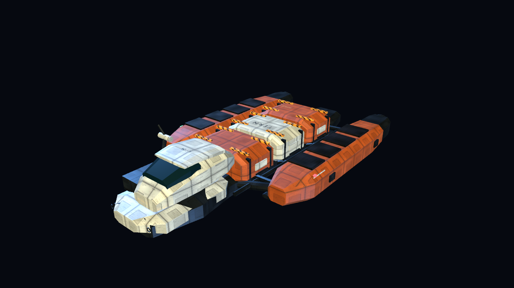
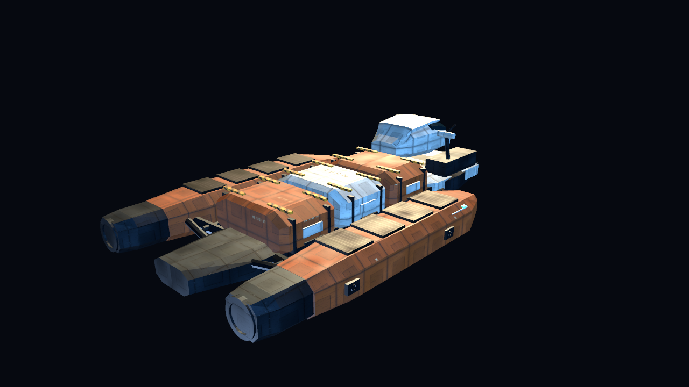
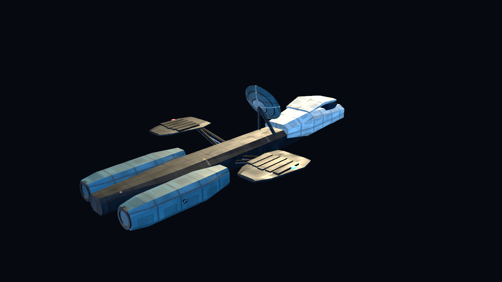
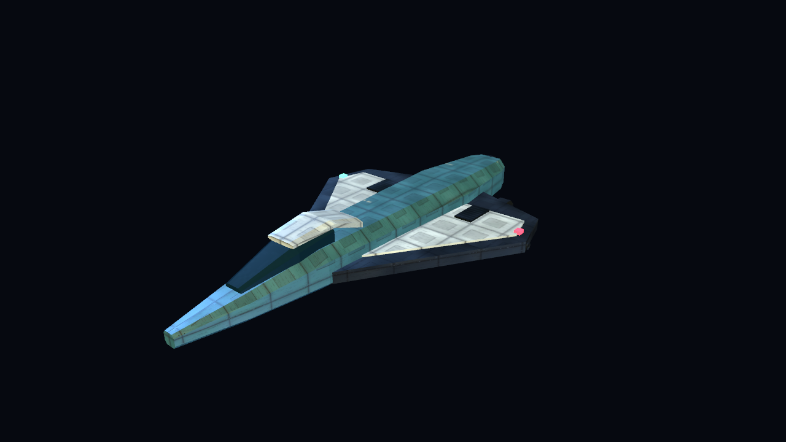
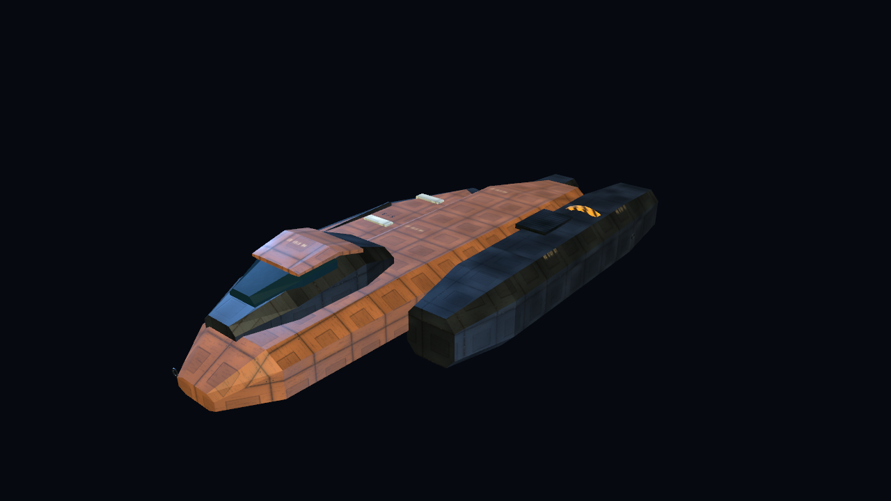
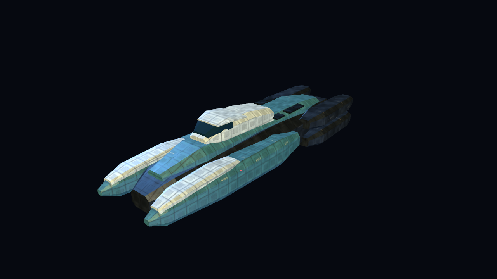
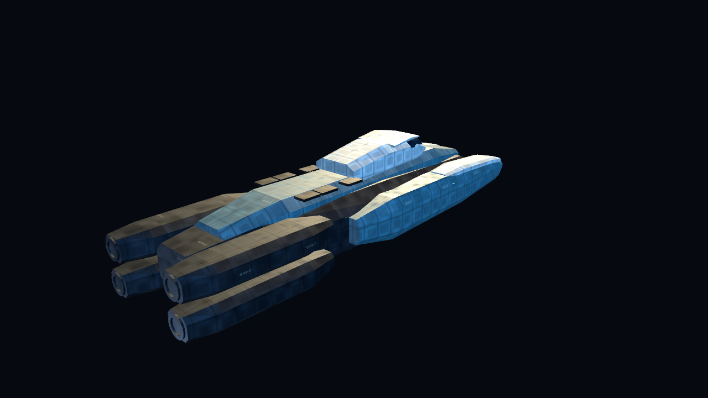

# Галерея флота (016)

| Корпус | Назначение | Ш × В × Д, м | Масса | Трюм | Обычный ход / форсаж | Сканер | Треугольники |
| --- | --- | --- | ---: | ---: | ---: | ---: | ---: |
| Wren | Курьер | 9,24 × 4,73 × 21,59 | 20 т | 40 | 260 / 720 м/с | 200 км | 16 740 |
| Tern | Лёгкий грузовой | 14,06 × 5,48 × 23,69 | 37 т | 86 | 220 / 610 м/с | 170 км | 5 044 |
| Mole | Добытчик | 10,62 × 5,62 × 18,88 | 33 т | 74 | 215 / 580 м/с | 140 км | 3 416 |
| Petrel | Исследователь | 14,02 × 5,70 × 25,90 | 22 т | 33 | 275 / 700 м/с | 300 км | 3 872 |
| Gannet | Тяжёлый грузовик | 15,26 × 5,35 × 43,41 | 110 т | 220 | 168 / 420 м/с | 155 км | 6 160 |
| Swift | Перехватчик | 11,50 × 2,90 × 19,59 | 13 т | 21 | 345 / 930 м/с | 235 км | 1 744 |
| Merlin | Корвет | 11,94 × 5,35 × 30,32 | 55 т | 58 | 236 / 665 м/с | 245 км | 2 496 |
| Shrike | Рейдер | 10,74 × 4,81 × 23,84 | 31 т | 49 | 272 / 743 м/с | 215 км | 2 800 |
| Halberd | Фрегат | 12,78 × 9,16 × 43,86 | 145 т | 112 | 154 / 432 м/с | 280 км | 3 940 |

Tern несёт три грузовые кассеты на открытой раме между двумя
гондолами. Кабина смещена к левому борту. Верх гондол занят радиаторами.
Геометрия включает узлы сцепки, защиты и обслуживающее оснащение.
Курьеры грузового узла используют Tern и берут до 10 единиц груза за рейс.
Wren остаётся стартовым кораблём и берёт 6 единиц за рейс NPC.

| Корпус | Нос | Корма |
| --- | --- | --- |
| Wren |  |  |
| Tern |  |  |
| Mole |  |  |
| Petrel |  |  |
| Gannet |  |  |
| Swift |  |  |
| Merlin |  |  |
| Shrike |  |  |
| Halberd |  |  |

[Внешняя камера в полёте](media/fleet/tern-flight.png) ·
[Кокпит Tern](media/fleet/tern-cockpit.png) ·
[Кокпит Mole](media/fleet/mole-cockpit.png) ·
[Кокпит Petrel](media/fleet/petrel-cockpit.png).

Кокпиты нового ряда:
[Gannet](media/fleet/gannet-cockpit.png) ·
[Swift](media/fleet/swift-cockpit.png) ·
[Merlin](media/fleet/merlin-cockpit.png) ·
[Shrike](media/fleet/shrike-cockpit.png) ·
[Halberd](media/fleet/halberd-cockpit.png).

У Mole высоко расположенный мостик между двумя рычагами с защитными
кольцами добычных головок. Petrel несёт открытую сегментированную антенну,
тонкий продольный корпус и боковые радиаторы. Добытчики используют Mole
для извлечения до 10 единиц из реальной залежи за цикл. Исследователи
используют Petrel и отмечают обследованные объекты.

Gannet несёт шесть ёмкостей и четыре движителя. Swift получил узкий
фюзеляж, крылья и одно главное сопло. Merlin ведёт патрулирование на
корпусе с двумя разнесёнными силовыми балками. Shrike сочетает
асимметричную защиту и вынесенную гондолу. Halberd имеет раздвоенный
нос, поднятый мостик и двухъярусную группу движителей.

## Воспроизведение

```bash
blender --background --factory-startup --python-exit-code 1 --python tools/art/build_ship_tern.py
blender --background --factory-startup --python-exit-code 1 --python tools/art/build_ship_professions.py -- mole
blender --background --factory-startup --python-exit-code 1 --python tools/art/build_ship_professions.py -- petrel
blender --background --factory-startup --python-exit-code 1 --python tools/art/build_ship_specialists.py -- gannet
python3 tools/art/export_collision_meshes.py
python3 tools/art/export_collision_meshes.py --check
blender --background --factory-startup --python-exit-code 1 --python tools/art/check_collision_blender.py
tools/run-server.sh --bind 127.0.0.1 --port 17894 --diagnostic-hull tern
tools/run-client.sh --server 127.0.0.1:17894
IS_FLEET_CAPTURE=/tmp/indifferent-fleet godot-dotnet --path client --resolution 1280x720 res://tests/FleetChecks.tscn
IS_SERVER=127.0.0.1:17894 IS_FLEET_PLAY=1 godot-dotnet --path client --resolution 1280x720 res://tests/FleetChecks.tscn
```

Исходники Tern — `tools/art/build_ship_tern.py`, запечённые UV/PBR 768² в
`tools/art/sources/ship_tern.blend` и итоговом GLB. Независимый импорт Blender
5.2.2 LTS подтвердил совпадение всех 5 044 треугольников с серверной
оболочкой. Godot 4.7.2 .NET запустил галерею и полёт со штатным UDP-сервером.
В двух независимых UDP-сокетах получены данные корпуса в приветствии
и снимке наблюдателя. Тест работы NPC подтвердил загрузку Tern из склада.

При тесте v1 → v2 на копии ранее созданного мира Godot получил тот же
корабль #10000, сохранение стало v2. Для проверки будущих обновлений
отпечатки коллизий в v2 охватывают корпуса, присутствующие в сохранении.

| RX 580, Forward+, 1280×720 | p95 60 кадров | Вызовы отрисовки | VRAM процесса по Godot |
| --- | ---: | ---: | ---: |
| Wren, галерея | 17,40 мс | 9 | 232,7 МиБ |
| Tern, галерея | 30,31 мс | 11 | 262,5 МиБ |
| Tern, полёт у станции | 17,02 мс | 146 | 421,0 МиБ |
| Mole, галерея | 16,89 мс | 10 | 292,1 МиБ |
| Petrel, галерея | 16,86 мс | 9 | 317,9 МиБ |
| Mole, полёт у станции | 17,13 мс | 145 | 420,9 МиБ |
| Petrel, полёт у станции | 17,05 мс | 144 | 416,9 МиБ |
| Gannet, галерея | 16,85 мс | 10 | 347,7 МиБ |
| Swift, галерея | 16,78 мс | 9 | 373,3 МиБ |
| Merlin, галерея | 16,80 мс | 9 | 398,8 МиБ |
| Shrike, галерея | 16,82 мс | 10 | 428,5 МиБ |
| Halberd, галерея | 16,82 мс | 9 | 454,2 МиБ |

Измерения включают ожидание кадра, драйвер и системную нагрузку.
VRAM относится ко всей сцене и может включать ранее загруженные ресурсы.
Этот короткий замер описывает конкретный запуск.

## Работа NPC и проверки

В 10-минутном автономном прогоне Release, seed 20261101, система 0,
19 NPC выполнили 32 доставки. Четыре Gannet выполнили 9 доставок,
пять Merlin — 35 патрульных задач. Два Mole провели пять добычных
циклов и три доставки, один Petrel завершил пять обследований.
На Xeon E5-2680 v4 p95 тика составил 2,984 мс, p99 — 4,123 мс,
максимум — 54,942 мс. Один из 12 000 тиков превысил 50 мс.

Прошли 210 .NET-тестов, независимое сравнение мешей в Blender и
импорт девяти корпусов в Godot. Gannet, Swift, Merlin, Shrike и Halberd
проверены в нативном полёте в F1/F2/F3. Сетевой тест столкновения проверяет
серверную точку контакта по мешу станции. К моменту получения снимка
центр корабля уже может отойти от поверхности после удара.

В игре проверены один, два и четыре главных сопла. Ионный след теперь
рисует ленту для каждого фактического сопла. В сцене EffectsChecks все
утверждения прошли, а тестовая камера отдельно вызвала диагностическое
сообщение Godot о расчёте пирамиды видимости при завершении.
Копия мира v2 с четырьмя корпусами загрузилась при расширении каталога
до девяти и продолжила ход времени с прежними корпусами у NPC.

Первый вариант каждого класса собран. Для целевого каталога остаются
вторые корпуса в восьми классах. Имена креплений и слоты заданы в данных.
Боевые сценарии и оборудование относятся к этапам 017–020.
