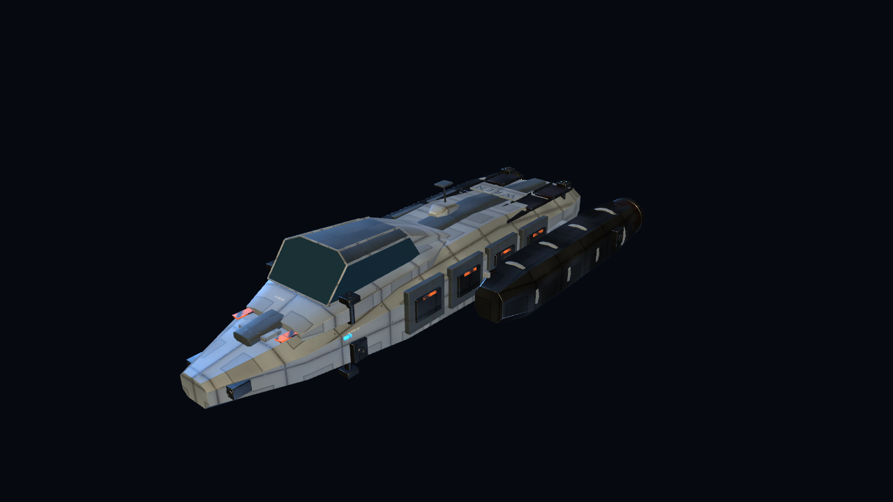

# Галерея флота (016)

| Корпус | Назначение | Ш × В × Д, м | Масса | Трюм | Обычный ход / форсаж | Сканер | Треугольники |
| --- | --- | --- | ---: | ---: | ---: | ---: | ---: |
| Wren | Курьер | 9,24 × 4,73 × 21,59 | 20 т | 40 | 260 / 720 м/с | 200 км | 16 740 |
| Tern | Лёгкий грузовой | 14,06 × 5,48 × 23,69 | 37 т | 86 | 220 / 610 м/с | 170 км | 5 044 |

Tern несёт три грузовые кассеты на открытой раме между двумя
гондолами. Кабина смещена к левому борту. Верх гондол занят радиаторами.
Геометрия включает узлы сцепки, защиты и обслуживающее оснащение.
Курьеры грузового узла используют Tern и берут до 10 единиц груза за рейс.
Wren остаётся стартовым кораблём и берёт 6 единиц за рейс NPC.

| Корпус | Нос | Корма |
| --- | --- | --- |
| Wren |  |  |
| Tern |  |  |

[Внешняя камера в полёте](media/fleet/tern-flight.png) ·
[Кокпит Tern у станции](media/fleet/tern-cockpit.png).

## Воспроизведение

```bash
blender --background --factory-startup --python-exit-code 1 --python tools/art/build_ship_tern.py
python3 tools/art/export_collision_meshes.py
python3 tools/art/export_collision_meshes.py --check
blender --background --factory-startup --python-exit-code 1 --python tools/art/check_collision_blender.py
tools/run-server.sh --bind 127.0.0.1 --port 17894 --diagnostic-hull tern
tools/run-client.sh --server 127.0.0.1:17894
IS_FLEET_CAPTURE=/tmp/indifferent-fleet godot-dotnet --path client --resolution 1280x720 res://tests/FleetChecks.tscn
IS_SERVER=127.0.0.1:17894 IS_FLEET_PLAY=1 godot-dotnet --path client --resolution 1280x720 res://tests/FleetChecks.tscn
```

Исходники Tern — `tools/art/build_ship_tern.py`, запечённые UV/PBR 768² в
`tools/art/sources/ship_tern.blend` и итоговом GLB. Независимый импорт Blender
5.2.2 LTS подтвердил совпадение всех 5 044 треугольников с серверной
оболочкой. Godot 4.7.2 .NET запустил галерею и полёт со штатным UDP-сервером.
В двух независимых UDP-сокетах получены данные корпуса в приветствии
и снимке наблюдателя. Тест работы NPC подтвердил загрузку Tern из склада.

При тесте v1 → v2 на копии ранее созданного мира Godot получил тот же
корабль #10000, сохранение стало v2. Для проверки будущих обновлений
отпечатки коллизий в v2 охватывают корпуса, присутствующие в сохранении.

| RX 580, Forward+, 1280×720 | p95 60 кадров | Вызовы отрисовки | VRAM процесса по Godot |
| --- | ---: | ---: | ---: |
| Wren, галерея | 17,40 мс | 9 | 232,7 МиБ |
| Tern, галерея | 30,31 мс | 11 | 262,5 МиБ |
| Tern, полёт у станции | 17,02 мс | 146 | 421,0 МиБ |

Измерения включают ожидание кадра, драйвер и системную нагрузку.
VRAM относится ко всей сцене и может включать ранее загруженные ресурсы.
Этот короткий замер описывает конкретный запуск.

## Продолжение этапа 016

Два корпуса покрывают курьера и лёгкий транспорт. Следующие проверяемые
корпуса — Mole для добычи и Petrel для исследований. Открыты тяжёлый
грузовик, перехватчик, корвет, пиратский рейдер, фрегат и вторые варианты
классов. Слоты и крепления заданы в данных. Монтаж оборудования и бой
относятся к последующим этапам.
