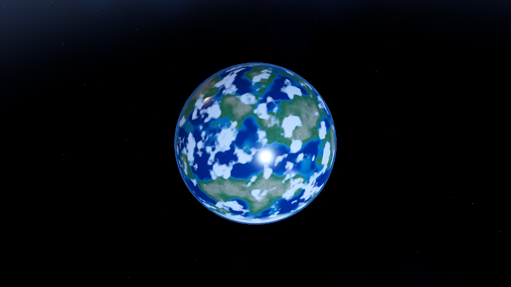
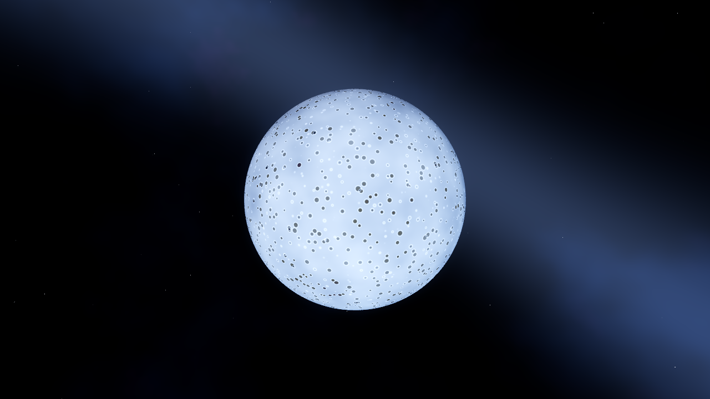
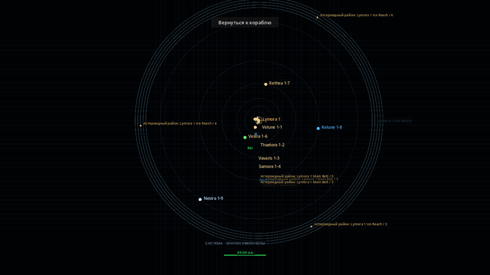
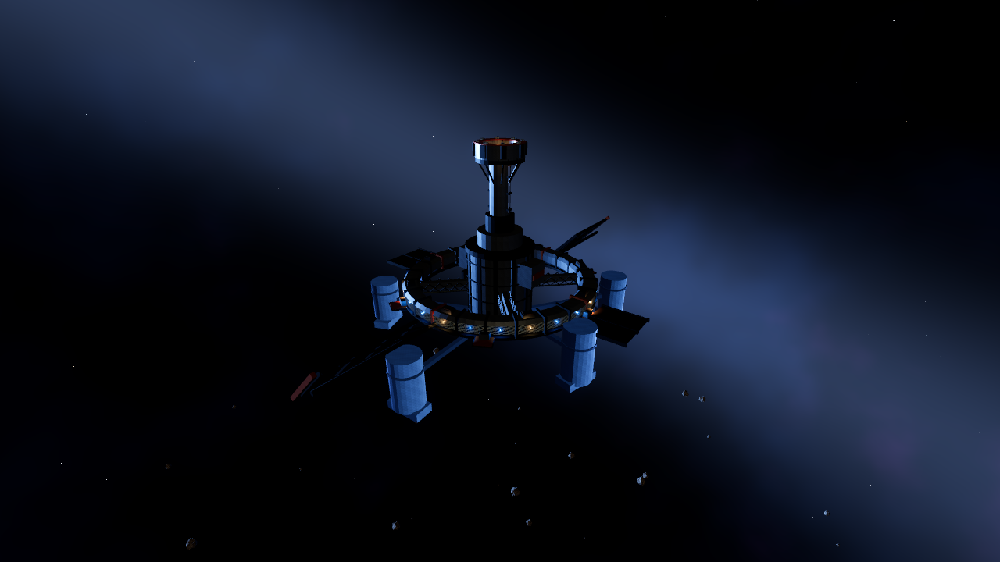
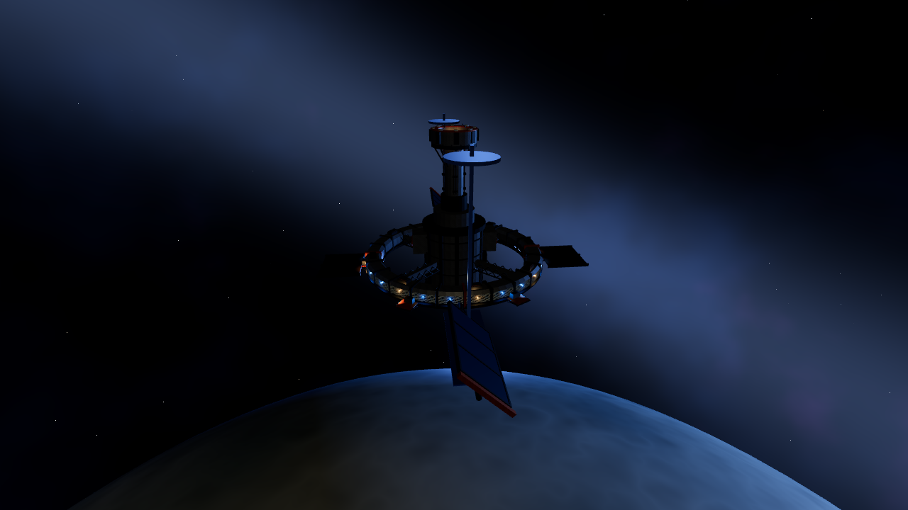
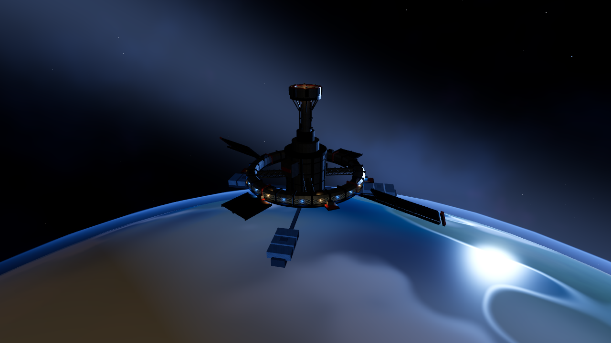
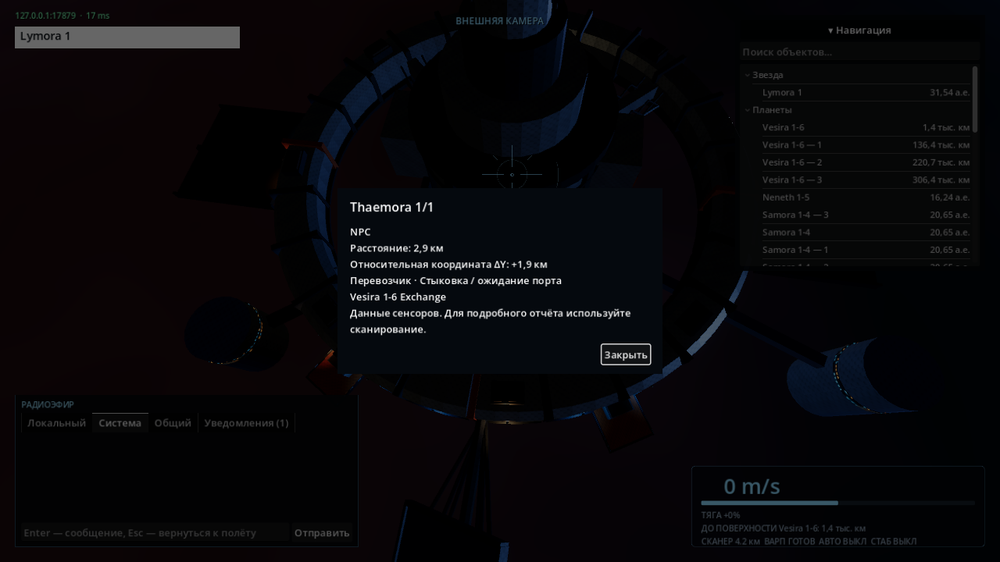
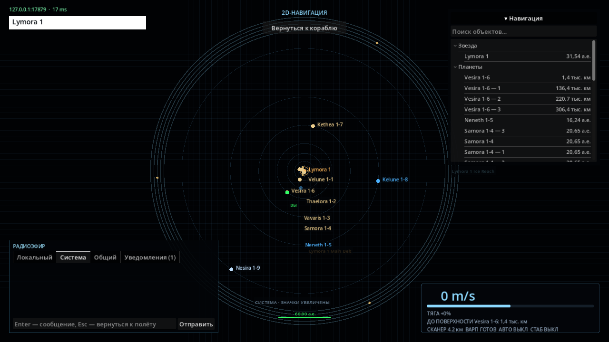
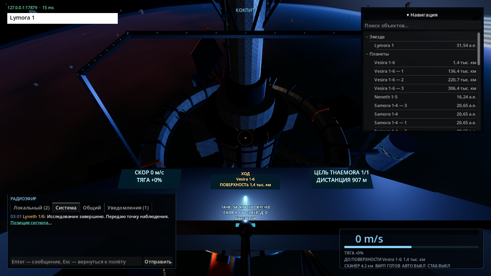
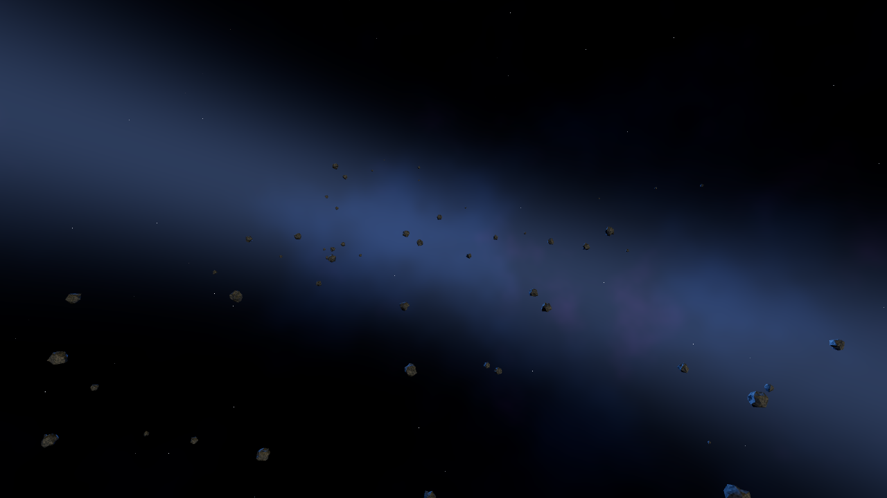

# Живая процедурная система — проверки этапов

## 1. Каталог и небесные тела

Генератор v2, протокол v18. Сид 20261101, система 0: 9 планет,
10 спутников и звезда; другие сиды дают 5–9 планет, другие имена,
физические параметры/поверхности и спутники. Землеподобный тип включён.
Фиксированный PRNG и независимые домены; галактическая схема 48–96 систем
со связным каркасом и дополнительными вратами/червоточинами. Схема связей
не означает реализованный полёт между системами.

```bash
dotnet build client/IndifferentStars.Client.csproj --no-restore
dotnet test tests/IndifferentStars.Tests --filter \
 'FullyQualifiedName~SeededSystemTests|FullyQualifiedName~WarpSafetyTests|FullyQualifiedName~ProtocolTests|FullyQualifiedName~GameWorldTests|FullyQualifiedName~ServerIntegrationTests.TwoClientsReconstruct'
godot-dotnet --headless --path client --editor --import --quit
godot-dotnet --path client --resolution 1280x720 res://tests/SeededSystemChecks.tscn
```

Сборка: 0 предупреждений/ошибок. Указанный набор тестов: **59/59**. Импорт и живой Forward+ на RX 580 — PASS:
отрисованы все типы планет, общий вид системы, шейдеры без ошибок.
SeededSystemTests проверяет 32 сида, уникальность id/имён внутри системы,
отсутствие пересечений с родителем, ближайшие поверхности, варп/орбиты,
детерминизм, различия сидов и связность топологии.
UDP-проверка двух клиентов подтверждает одинаковый каталог системы 7
на сиде 81472, включая SystemIndex из HelloAccepted.





Дальнейшие этапы 012: распределённые районы и станции, занятия NPC и события.
Технический успех первого этапа не означает завершение всего задания.

## 2. Районы, станции и компоновки

На этапе v2 сид 20261101: 4 станции с отдельными складами и портами, два пояса и
6–10 распределённых карманов ресурса (число/содержимое зависит от сида).
Станции используют общее текстурированное ядро, но имеют собственные
генерируемые секции и силуэты по DesignSeed и назначению. Неизменённый GLB
не выдаётся за уникальную целиком авторскую модель каждой станции.

Проверки после последней правки: **72/72** (RegionalSystemTests, SeededSystemTests,
GameWorldTests, Docking, SurfaceCollisionTests, ProtocolTests), 14 с.
Сборка клиента: 0 предупреждений/ошибок. SeededSystemChecks в живом Forward+
проверяет точность дальних координат станции и астероидов, сравнивает каждый
треугольник новых секций с общей геометрией, стриминг всех ресурсных районов,
сохраняет четыре вида станций и системный обзор. PASS, ошибок шейдеров нет.
Отдельные склады/занятость портов, варп 500 м у дальних станций, CCD по настоящей
оболочке вдали от стартового origin, разные компоновки сидов — PASS.
Протокол v19 добавляет DockingStationId; сканер показывает настоящий тип
поверхности/звезды и назначение станции вместо старых фиксированных описаний.






## 3–4. Работа NPC и события (проверка перед слиянием, 2026-11-04)

Текущие версии: генератор v3, протокол v20. Всего 4–6 станций по сиду,
по 2–3 NPC на станцию; на сиде 20261101 — 13 NPC и 758 статических объектов
(753 астероида и 5 станций). Перевозки списывают и доставляют настоящий груз,
добыча уменьшает залежь; обследование и патруль требуют прибытия к цели.
Нет сохранений, производства, боевых патрулей или перелётов между системами.

Свежие проверки Godot 4.7.2 .NET перед слиянием:

- Сборка клиента и headless-импорт редактором: код 0, без ошибок.
- SurfaceGeometryChecks: PASS, GLB совпадает с серверной геометрией.
- SeededSystemChecks: PASS, 20 небесных тел, все типы планет, станции,
  треугольники секций, перенос origin и стриминг ресурсных районов.
- LivingSystemChecks: PASS, два независимых UDP-клиента согласны о занятиях
  NPC и системном событии #12 от Lyneth 1/6. Событие возникло в обычной симуляции,
  позиция открывает меню точки, план маршрута подтверждается сервером и
  не запускает автопилот. Проверены F1/F2/F3 и окно информации.

Нативный запуск: Linux, RX 580 2048SP / RADV, Forward+, 1280×720,
VSync по умолчанию, один рендерер и два сетевых клиента. Выборка 2520 кадров:
p95 16,67 мс. Это наблюдение конкретного сценария с ограничением VSync,
не обещание FPS и не предельная нагрузка. Одновременно шли .NET-тесты.

Воспроизведение (сервер в отдельном терминале):

```bash
dotnet build IndifferentStars.slnx
dotnet test IndifferentStars.slnx --no-build
dotnet build client/IndifferentStars.Client.csproj
godot-dotnet --headless --path client --editor --import --quit
dotnet run --no-build --project src/IndifferentStars.Server -- --bind 127.0.0.1 --port 17879
# В другом терминале:
IS_SERVER=127.0.0.1:17879 godot-dotnet --path client --resolution 1280x720 \
  res://tests/LivingSystemChecks.tscn -- --server 127.0.0.1:17879
```






CPU-диагностика `dotnet run --project tools/IndifferentStars.Diagnostics -- --life 1200`:
1200 тиков по 0,05 с, 13 NPC, 758 статических объектов, без игроков;
p50 2,328 мс, p95 26,2423 мс, max 35,4745 мс. Одновременно исполнялся полный
набор тестов. CPU: Intel Xeon E5-2680 v4 @ 2,40 GHz, 28 логических CPU;
это наблюдение на занятой машине, не изолированный бенчмарк и
не доказательство целевого количества игроков. Условия следует фиксировать при последующих сравнениях производительности.


### Исправление выбора астероидного района

По замечанию владельца маркер района получил явную подпись. Ранее выбор
его проекции как свободной точки терял координату Y, поэтому варп мог вести
в пустоту над/под настоящим скоплением. Теперь точка в пределах 12 пикселей
маркировки привязывается к полному центру района. Сборка клиента: 0 ошибок и
предупреждений. Повторный SeededSystemChecks в Forward+ — PASS: для каждого
маркера выбранная точка совпадает с центром в пределах 1 мм, в радиусе 15 км
есть реальные астероиды; стриминг районов и точность геометрии также проверены.



Дополнительная диагностика 5000 тиков без игроков: p50 10,269 мс,
p95 28,0097 мс, max 48,7183 мс, 95 событий; тот же сид и параллельный
общий прогон тестов. Начальные 400 тиков тестового свободного полёта
сохранены как проверка: скорость (0, −720, 0) м/с, столкновений нет.


Итоговый полный прогон перед слиянием: `dotnet build IndifferentStars.slnx`
— 0 предупреждений и ошибок; `dotnet test IndifferentStars.slnx --no-build`
— **179/179 PASS**, код 0, 16,4656 мин. Включён получасовой свободный полёт
(36 000 тиков), доставка NPC без игроков, общие коллизии, орбиты, варп,
рынки, протокол и независимые UDP-клиенты. Длительность этого теста не является
оценкой FPS клиента или гарантий производительности сервера под нагрузкой.
