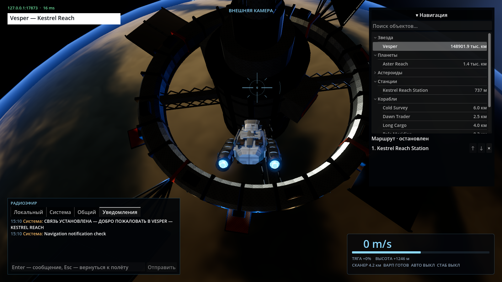
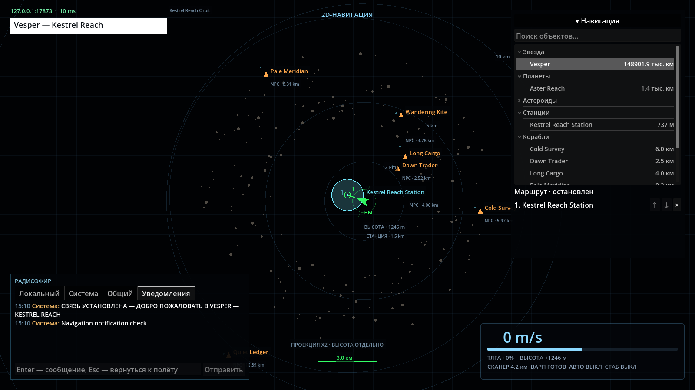
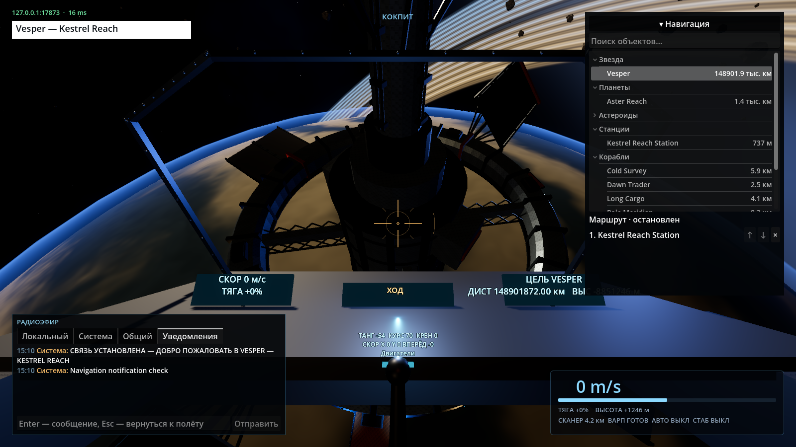
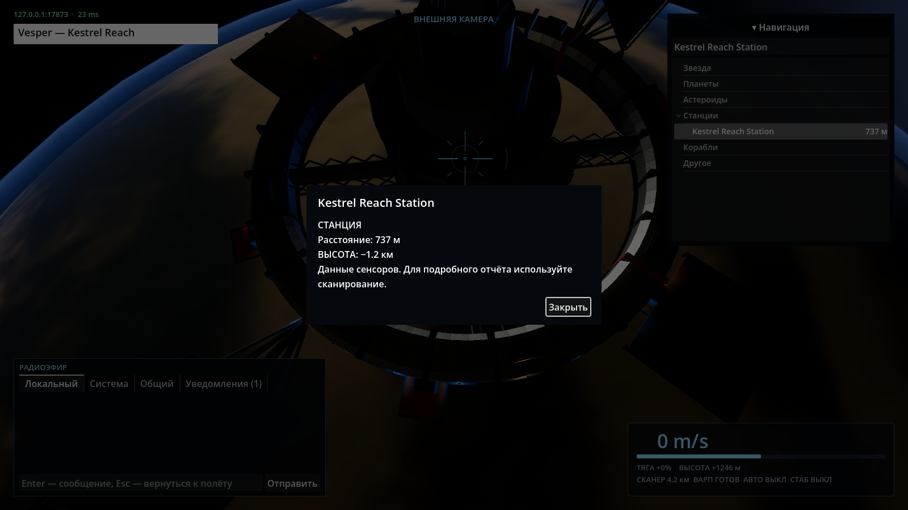

# Проверка интерфейса и маршрутов (008)

Linux/Debian, .NET 10, Godot 4.7.2 .NET, Forward+, Radeon RX 580 2048SP
(RADV POLARIS10), окно 1600×900, MSAA 2×. Дата: 2026-11-03.
Ветка: `feat/navigation-interface`. Протокол v16, обновлять сервер и клиент вместе.

## Команды и результаты

```bash
dotnet build
dotnet build client/IndifferentStars.Client.csproj
dotnet test tests/IndifferentStars.Tests

godot-dotnet --headless --path client --editor --import --quit
```

Обе сборки: 0 ошибок, 0 предупреждений. Полный набор серверных тестов:
139/139, 9 мин 11 с. После заключительных изменений формата снимка,
безопасного торможения и редактирования в варпе отдельно повторены проверки:

```bash
dotnet test tests/IndifferentStars.Tests --filter 'FullyQualifiedName~NavigationRouteTests|FullyQualifiedName~TwoClientsObserveCruiseSafetyAndAuthoritativeWaypoints|FullyQualifiedName~ProtocolTests'
```

43/43: сериализация, границы пакетов, планирование без запуска, порядок точек,
завершение, ручная отмена, невалидные цели/координаты, отход на форсаже,
круиз и варп, правка плана во время текущего варпа. Два UDP-клиента проверяют
одинаковую ревизию/активность маршрута, повторы, отклонение устаревшего запроса
и остановку. Существующие тесты докинга и коллизий входят в полный прогон.

Импорт редактором завершился успешно. Автоматизированные проверки живого
клиента запускались с отдельным headless-сервером:

```bash
dotnet src/IndifferentStars.Server/bin/Debug/net10.0/IndifferentStars.Server.dll --port 17873
# В другом терминале, по очереди:
godot-dotnet --path client --resolution 1600x900 res://tests/NavigationInterfaceChecks.tscn -- --server 127.0.0.1:17873
godot-dotnet --path client --resolution 1600x900 res://tests/RadioChecks.tscn -- --server 127.0.0.1:17873
godot-dotnet --path client --resolution 1600x900 res://tests/ScanRecoveryChecks.tscn -- --server 127.0.0.1:17873
```

- NavigationInterfaceChecks: PASS. Шесть групп, аккордион, поиск при вводе,
  подавление полётных клавиш при поиске, Tab без смены цели, общее меню,
  модальное окно, планирование без движения, перестановка/удаление, G,
  вкладка уведомлений только для чтения, F1/F2/F3, единицы расстояния.
- RadioChecks: PASS. Второй независимый NetworkClient, доставка трёх сетевых
  каналов, NPC, непрочитанное, обычный текст без BBCode, дедупликация,
  фокус, прокрутка и ограниченная история.
- ScanRecoveryChecks: PASS. Успешный и отклонённый сканы, таймаут,
  повтор ответа, сохранение полёта и запись результатов в уведомления.
- В итоговых журналах этих сцен ошибок Godot нет. Обнаруженная при разработке
  ошибка фокуса Window устранена: модальный слой встроен в общий Control UI,
  блокирует нижележащий ввод и закрывается кнопкой или Escape.

Кадры просмотрены: длинное расстояние до звезды помещается в правой колонке,
адрес/ping и белая плашка системы читаются, чат и навигация одинаковы в трёх видах.

| Внешняя камера | Карта | Кокпит |
| --- | --- | --- |
|  |  |  |



## Ограничения

- Маршрут ограничен 24 точками; история уведомлений — 100 записями сеанса.
  Нет сохранения плана на диск и восстановления на другом сервере.
- Обход сложных препятствий не добавлен. Непрерывные серверные коллизии
  останавливают маршрут; недоступная цель или отказ варпа также требуют
  решения капитана. Линия карты показывает назначения, не гарантированный коридор.
- Ближние участки до 1000 км проходят без обязательного круиза/варпа.
  Дальний участок требует достаточного места для безопасного крейсерского разгона.
- Правка/остановка в варпе не телепортирует корабль и не прерывает текущий
  переход; новый план исполняется после безопасного выхода.
- Модальное окно показывает доступные сенсорные сведения; подробный отчёт
  сканирования остаётся в истории уведомлений и подчиняется прежней дальности.
- LSP-инструменты в сессии не предоставлены; диагностика C# выполнена компилятором.
  Windows и художественная приёмка владельцем не проверялись.

Следующий предлагаемый этап — пользовательская проверка плотности интерфейса
и поведения нескольких маршрутов в обычной игре; отдельная задача при необходимости.
