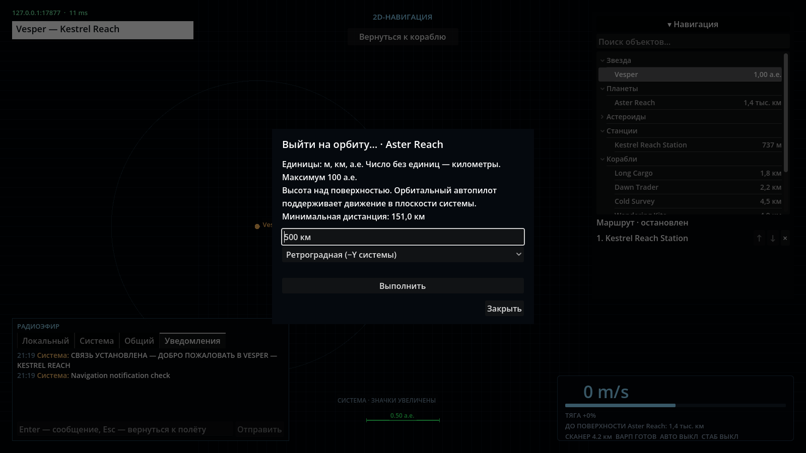
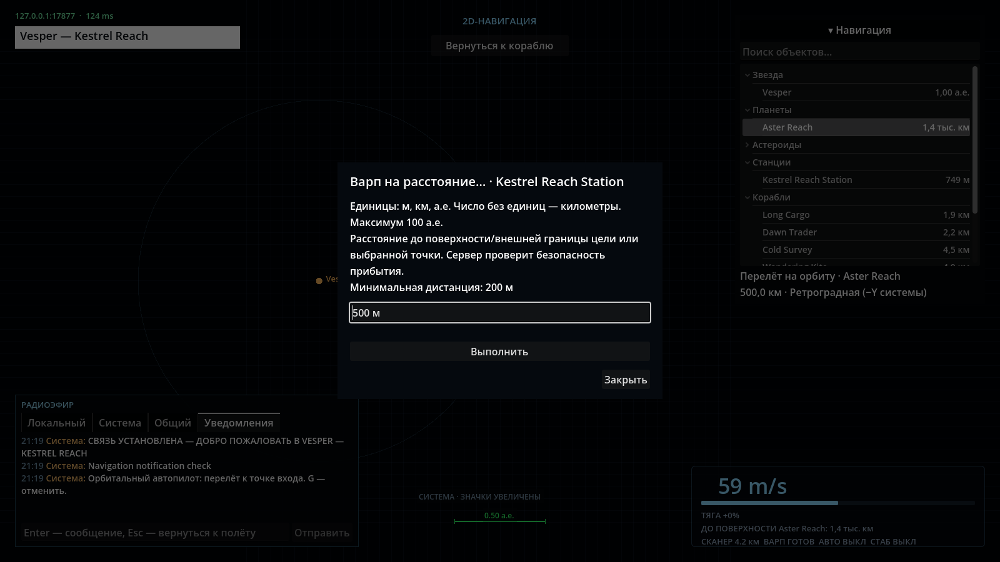
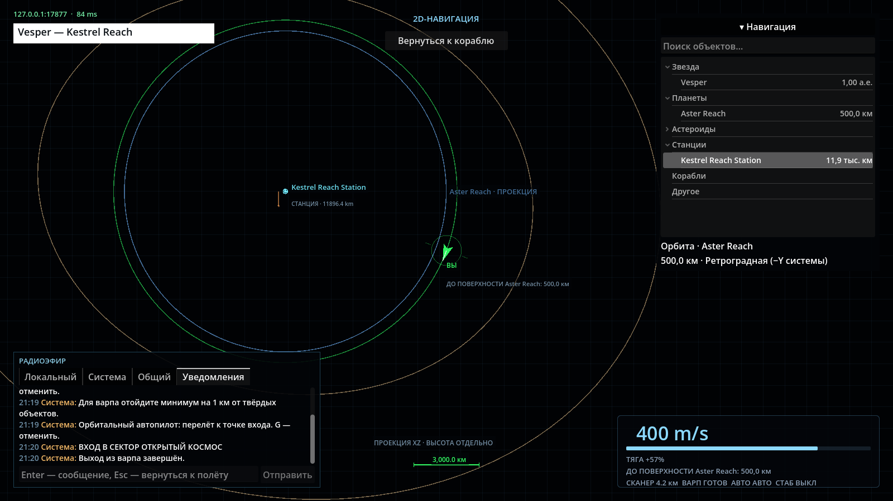
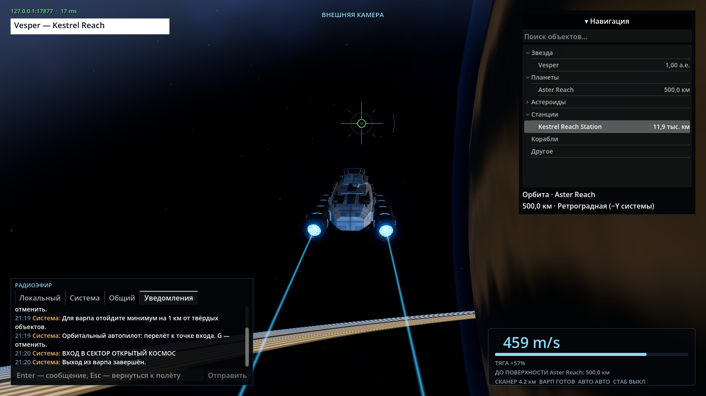
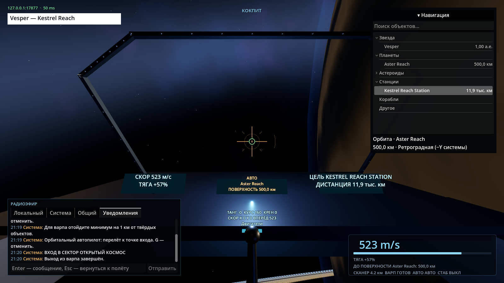

# Проверки орбитальной навигации — 2026-11-03

## Поведение

- HUD/кокпит/карта: ближайшее небесное тело и расстояние до его поверхности,
  без абсолютной «высоты» локальной системы. Правка включена в main вместе с Vesper:
  `70c0bbe` поверх `3721222`.
- F1 следует за игроком. Панорамирование отключает слежение; Home и кнопка
  «Вернуться к кораблю» немедленно центрируют экран и возобновляют слежение.
  Системные координаты Vesper не меняются.
- Общие контекстные меню: докинг только у станции; орбита только у звезды/планеты;
  стандартный варп и варп с вводимым отступом. Диалог фиксирует выбранную цель.
- Орбита: высота над поверхностью, проградное/ретроградное направление,
  серверный перелёт к входу и непрерывное движение. G останавливает режим,
  в том числе снимает последующий орбитальный приказ во время варпа.
- Ввод м/км/а.е., m/km/AU, точка/запятая; без единиц — км. Минимумы проверяет
  сервер: локальная оболочка 200 м, планета атмосфера+5 км, звезда 1000 км.
  Высота орбиты дополнительно оставляет CruiseClearance+1 км над атмосферой.

## Автоматические проверки

```bash
dotnet build IndifferentStars.slnx
dotnet build client/IndifferentStars.Client.csproj
dotnet test IndifferentStars.slnx --logger 'console;verbosity=normal'
```

Сборки — 0 предупреждений, 0 ошибок. Полный прогон — **160/160**, 9,12 мин;
включает получасовой полёт (36 000 серверных тиков), протокол, коллизии,
маршруты и настоящий UDP-сервер с независимыми клиентами.
После полного прогона добавлены ещё два сценария занятой точки **пользовательского**
варпа (на подготовке и выходе); расширенный набор — **70/70**, 18,88 с:

```bash
dotnet test tests/IndifferentStars.Tests --filter \
 'FullyQualifiedName~OrbitalNavigationTests|FullyQualifiedName~WarpSafetyTests|FullyQualifiedName~NavigationRouteTests|FullyQualifiedName~ProtocolTests|FullyQualifiedName~ServerIntegrationTests.TwoClientsObserveOrbit'
```

Проверены: разные единицы и некорректные числа, высота от поверхности,
движение/высота обоих направлений за 600 с, полный трансфер от станции,
отмена режима, отсутствие переноса позиции командой, сохранение принятого
приказа при отказе, реальные 500 м до mesh-оболочки станции, запрет опасного
прибытия к звезде/планете и обхода через точку карты, занятая точка прибытия.
После последнего сброса флага следования при входе на орбиту повторены затронутые
орбитальные/маршрутные/UDP-проверки: **27/27**, 18,57 с. Новый приказ не наследует
режим следования от предыдущей цели.

UDP-тест подтверждает одинаковые параметры орбиты/отмену у пилота и наблюдателя,
дубликат с другим содержимым не перезапускает приказ, старый id отклоняется.

## Godot и работающий клиент

```bash
godot-dotnet --headless --path client --editor --import --quit
godot-dotnet --headless --path client --script res://tools/verify_resources.gd -- --record
godot-dotnet --headless --path client res://tests/ShipTrackChecks.tscn
```

Импорт, загрузка моделей/всей музыки/C#-сцены, интерполяция/устаревшие пакеты/
переподключение, стриминг и переход планеты к истинному масштабу — PASS.

В одном терминале:

```bash
dotnet run --project src/IndifferentStars.Server -- --bind 127.0.0.1 --port 17877
```

В другом, после сборки клиента:

```bash
XDG_DATA_HOME=/tmp/is-nav-ui-data IS_SERVER=127.0.0.1:17877 \
 IS_ORBIT_FLIGHT=1 IS_NAVIGATION_CAPTURE=/tmp/indifferent-navigation-orbit \
 godot-dotnet --path client --resolution 1600x900 res://tests/NavigationInterfaceChecks.tscn
```

Настоящий Forward+ / Vulkan на RX 580 2048SP, Godot 4.7.2 .NET — PASS.
Проверяются фильтр/сортировка, Tab, контекстные меню по типу, модальные диалоги
и блокировка ввода, планирование/перестановка/удаление маршрута, ручное включение G,
кнопка возврата/панорамирование/системный центр, единицы, орбита и её отмена,
безопасный отказ варпа со стоянки, уведомления и все три вида.

Расширенный сценарий действительно летит со станции до орбиты Aster Reach
500 км, ждёт движения и переключает F1/F2/F3. В контрольной точке после начала
движения расстояние до поверхности **499 998,47 м**; скорость при кадре кокпита
**522,8 м/с** (ещё разгон). Измерения относятся к этому сценарию, не ко всем
высотам/системам. Итоговый лог не содержит ERROR/SCRIPT ERROR.

При первом прогоне обнаружен вырожденный frustum камеры кокпита при большой
дальности до отрисованных колец: `Projection.get_z_far()` возвращал infinity.
Ближняя граница теперь не меньше Far/8 000 000. В повторном живом прогоне
Near=0,1580 м, Far=1 263 769 м, извлечение frustum конечное, приборы/рама видны.
Источник для диагностики пересечений плоскостей:
[Godot RenderingLightCuller](https://github.com/godotengine/godot/blob/master/servers/rendering/rendering_light_culler.cpp).







## Ограничения

Орбитальный режим — временный серверный контроллер в XZ, без гравитации и
произвольного наклонения. Произвольный обход препятствий не реализован;
круизная безопасность и непрерывные коллизии сохраняются. Заданный отступ
ограничен 100 а.е.; дальность обычного варпа не получила нового предела.
Проверка на RX 580 подтверждает работу сценария, отдельный FPS-бенчмарк
для этой задачи не проводился. Сервер и клиент должны оба использовать v17.
