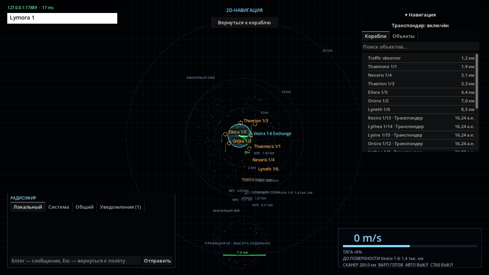
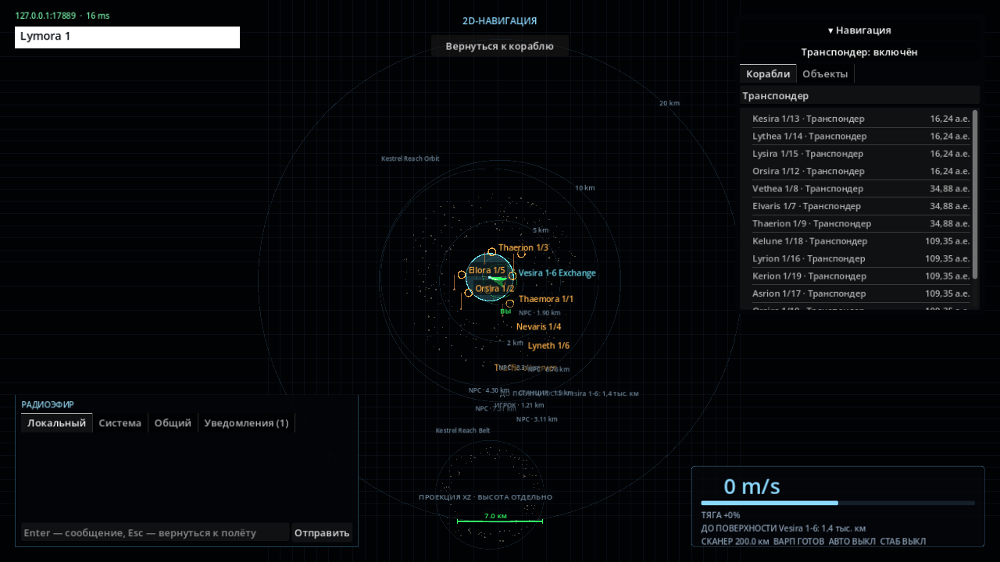
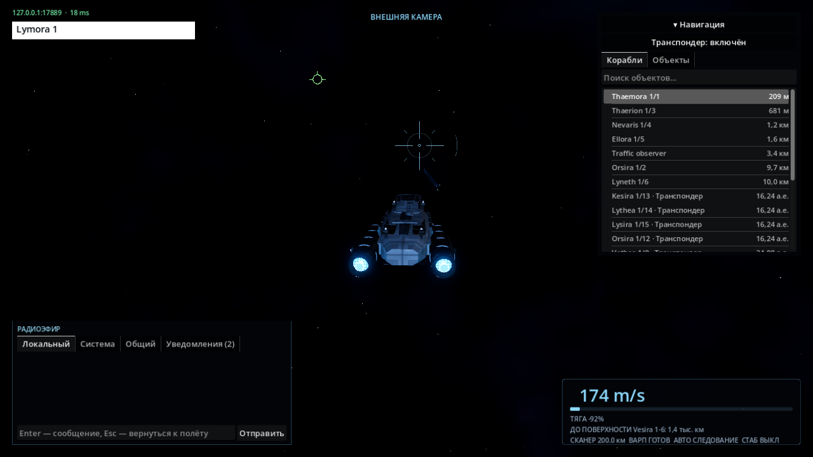
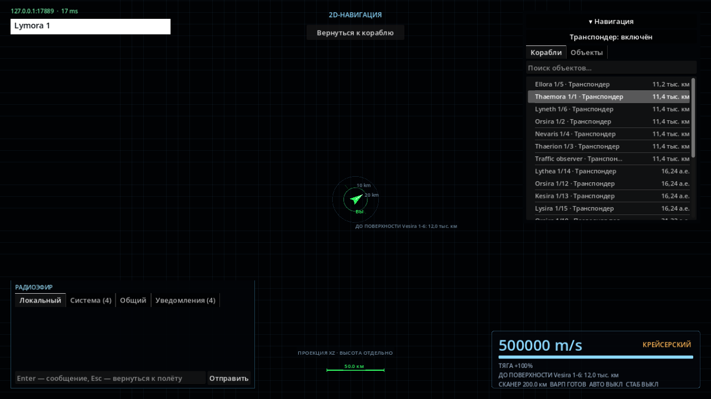
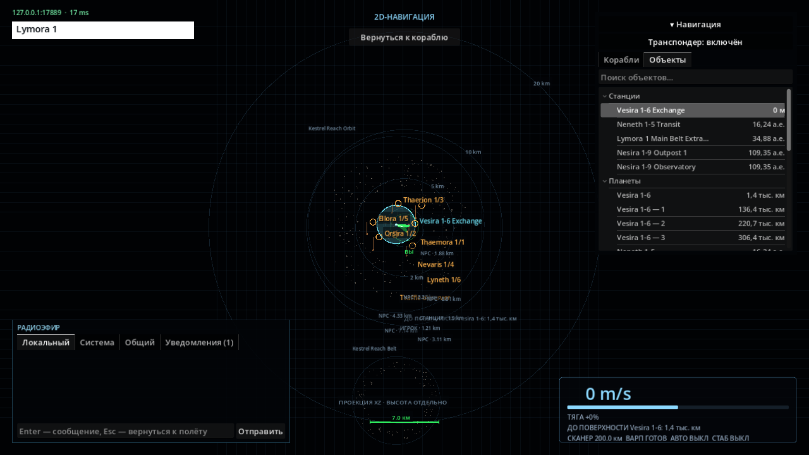

# Проверки населённого космоса (013)

## Параметры и результат

Обычный полёт — 260 м/с, форсаж — 720 м/с. Круиз — 150 км/с в 5000-км
районе станции, 500 км/с в свободном пространстве; ускорение 20 км/с²,
торможение 30 км/с². Переход между пределами плавный, с учётом тормозного пути.
Размеры небесных тел, астрономические расстояния и модели корабля не менялись.

Сканер — 200 км. Подробные снимки — 150 км / 20 Гц. Тактическое обнаружение —
3000 км. Дальние анонимные двигательные/групповые сигналы — 75 000 км.
Гражданские транспондеры — вся активная система, отдельный поток 1 Гц.
Сигналы округлены до 100 км; группа — минимум 4 корабля в 100-км окрестности.
Последняя известная позиция хранится 10 с, затем помечается потерянной до 60 с.

В 12 системах seed 20261101: 15–39 работающих NPC, среднее 26,75.
Численность за конкретный прогон постоянна; корабли не создаются по таймеру
появления игрока. Торговые, добывающие, научные и грузовые узлы имеют разный
состав экипажей. Это выборка, а не доказанный верхний предел сервера.

За 10 минут симуляции системы 0 без игроков: 132 отправления, 41 реальная
доставка, 5 событий добычи. У стартовой станции в радиусе 150 км находились
в среднем 4,36 корабля, максимум 6. Перевозки изменяли склады, добыча — залежи.
Физика и автономная работа не зависят от присутствия игроков или вида камеры.

## Серверная производительность

Linux x86_64, Xeon E5-2680 v4 2,4 ГГц, .NET 10 Debug, шаг 0,05 с, без игроков.
Stopwatch охватывает Tick целиком, включая JIT/GC/планирование. Прогоны имеют
разное число NPC и длительность; это наблюдения конкретных сценариев,
а не обещание производительности или статистически строгий бенчмарк.
Исходные численные результаты и перепись: [metrics/populated-space.json](metrics/populated-space.json).

| Состояние | NPC | Тики | Среднее, мс | p50, мс | p95, мс | max, мс |
| --- | ---: | ---: | ---: | ---: | ---: | ---: |
| Исходное 9b443cc, 50 с | 13 | 1000 | не измерялось | 2,061 | 4,572 | 32,898 |
| Первая попытка увеличения, отклонена | 19 | 1000 | 53,471 | 63,882 | 95,876 | 662,935 |
| После безопасного отхода, 50 с | 19 | 1000 | 2,398 | 2,022 | 5,247 | 36,906 |
| Та же система, 10 мин | 19 | 12000 | 8,402 | 2,784 | 21,861 | 267,988 |
| Населённая система 7, 100 с | 39 | 2000 | 4,724 | 4,279 | 6,212 | 55,958 |

Для 10-минутного прогона: маршруты 0,486 мс/тик, круизная безопасность 0,349,
коллизии 7,703 (статика 7,306, корабли 0,396). Замеры маршрутов и безопасности
частично вложены друг в друга, их нельзя складывать как независимые доли.
Диагностические счётчики по умолчанию выключены на обычном сервере.

Первое превышение бюджета вызвал прямой курс добытчика через собственную
станцию с дорогими повторными контактами. Добавлены настоящий маршрут отхода,
проверка начальной позиции и уточнение консервативного вращательного охвата CCD.
Точный mesh solver, проходимые отверстия и серверные импульсы сохранены.

Воспроизведение:

```bash
dotnet run --project tools/IndifferentStars.Diagnostics -- --life 1000 20261101 0
dotnet run --project tools/IndifferentStars.Diagnostics -- --life 12000 20261101 0
dotnet run --project tools/IndifferentStars.Diagnostics -- --life 2000 20261101 7
```

Аргументы: число тиков, seed, индекс системы. Печатаются население, тайминги,
узкие места, отправления/прибытия/добыча и доставки.

## Автоматические проверки

```bash
dotnet build IndifferentStars.slnx
dotnet test tests/IndifferentStars.Tests
dotnet build client/IndifferentStars.Client.csproj
godot-dotnet --headless --editor --path client --import
godot-dotnet --headless --path client res://tests/ShipTrackChecks.tscn
godot-dotnet --headless --path client res://tests/CruiseCoastChecks.tscn
tools/tests/check-client-startup.sh
```

Итоговый полный набор .NET: **199/199 PASS**, без пропусков, 7 мин 3 с.
В него входят детальные/тактические/дальние контакты, границы сенсоров,
транспондеры и потеря/возврат контакта, анонимные скопления, ограничения пакетов,
два UDP-клиента и идемпотентные подтверждения, реальная доставка без игроков,
коллизии и тормозной путь на 100/200/500 км/с, стыковка, варп и получасовой полёт.
Сборки решения и клиента — без ошибок и предупреждений. Импорт Godot — PASS.
Сцены ShipTrack/Streaming/Coast и проверки скрипта запуска — PASS.

Новый тест сначала воспроизвёл сброс интерполяции уже на 100 км/с. После правки
100/200/500 км/с интерполируются; прежний настоящий скачок всё ещё сбрасывает
историю. Поток астероидных ресурсов отделён от дальности сетевых снимков.
Старая проверка углового размера адаптирована к реальным координатам и размерам
процедурного газового гиганта: дальние образцы находятся вне существующего
проекционного ограничения 1,45 рад, последний образец проверяет истинный масштаб.
Сам рендерер планеты не менялся.

## Реальный графический прогон

RX 580 2048SP / RADV, Forward+, 1280×720, стандартный VSync. Отдельный процесс
авторитетного сервера, два независимых сетевых клиента, один графический клиент.
Тест не устанавливает позицию игрока или NPC: сближение, отход и круиз выполняются
через серверные приказы и обычный ввод клиента.

```bash
# Терминал 1
dotnet run --project src/IndifferentStars.Server -- --bind 127.0.0.1 --port 17889
# Терминал 2
XDG_DATA_HOME=$(mktemp -d) IS_SERVER=127.0.0.1:17889 \
  IS_POPULATED_CAPTURE=/tmp/indifferent-populated \
  godot-dotnet --path client --resolution 1280x720 res://tests/PopulatedSpaceChecks.tscn
```

**PASS:** системные контакты и согласованная идентификация у двух клиентов;
транспондер включён/выключен и защита от старого подтверждения; вкладки
«Корабли»/«Объекты» и поиск; реальное сближение с NPC до 196,7 м за 24,7 с;
100/200/500 км/с; F1/F2/F3; сохранение инерции; торможение с 500 км/с;
принятый маршрут к дальнему контакту. В открытом пространстве осталось
20 записей контактов (19 NPC и второй игрок), ближних кораблей — 0.
Контрольная секунда на 500 км/с: 60 кадров, максимальный шаг изображения
1,038 от ожидаемого по скорости и времени кадра. Это короткая проверка
плавности данного сценария, не гарантия FPS.

Дополнительно `LivingSystemChecks.tscn` — PASS: одинаковое реальное системное
событие #148 у двух клиентов, положение источника, клик по сообщению,
контекстное меню и планирование маршрута без автоматического начала движения.
В этой выборке 709 кадров, p95 кадра 17,01 мс.

Контрольные кадры:

| Населённый район | Дальние транспондеры |
| --- | --- |
|  |  |

| Реальный NPC в 3D | Открытое пространство на 500 км/с |
| --- | --- |
|  |  |



## Ограничения

- p95 итоговых измеренных серверных сценариев укладывается в 50 мс, но отдельные тики
  превышают бюджет, до 267,99 мс в 10-минутном прогоне. Жёсткая гарантия 20 Гц
  для каждого тика и поддержка сотен NPC/игроков не доказаны.
- Отдельный дальний LOD физики не вводился: варп аналитический, кандидаты
  коллизий отсеиваются пространственным индексом, удалённые корабли не создают
  подробные клиентские модели. События и грузы сохраняют общий порядок симуляции.
- Дальние контакты обновляются раз в секунду; это сообщения о состоянии,
  а не обещание неподвижной цели. Координаты и безопасность перепроверяет сервер.
- В headless CruiseCoastChecks остаются сообщения Godot о трёх ObjectDB и одном
  ресурсе при немедленном завершении тестовой сцены; функциональные проверки
  проходят. В полном графическом PopulatedSpaceChecks ошибок/предупреждений нет.
- Художественная оценка читаемости кораблей и дальнейшая балансировка открыты.
  Следующий предлагаемый этап — профилирование редких длинных серверных тиков.
