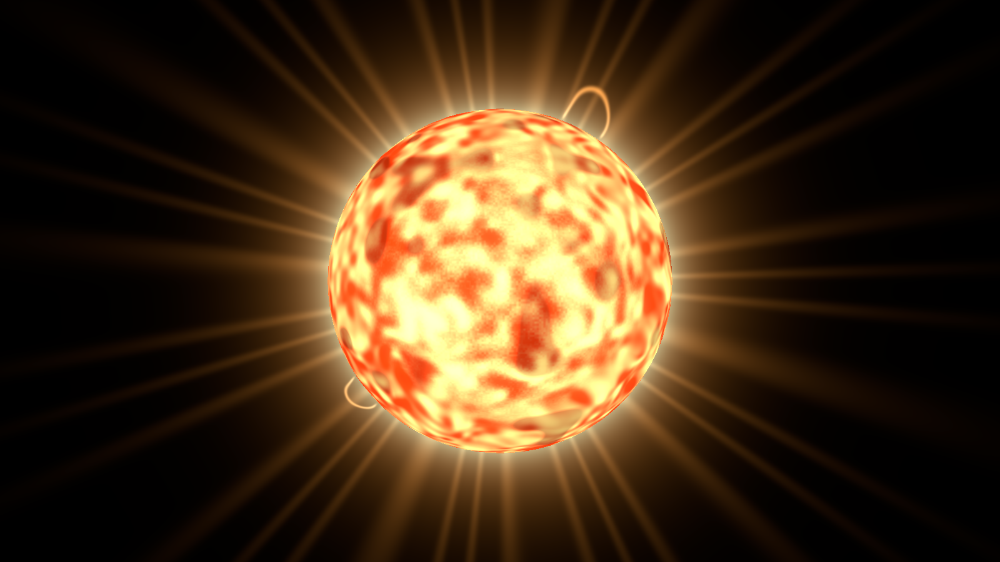
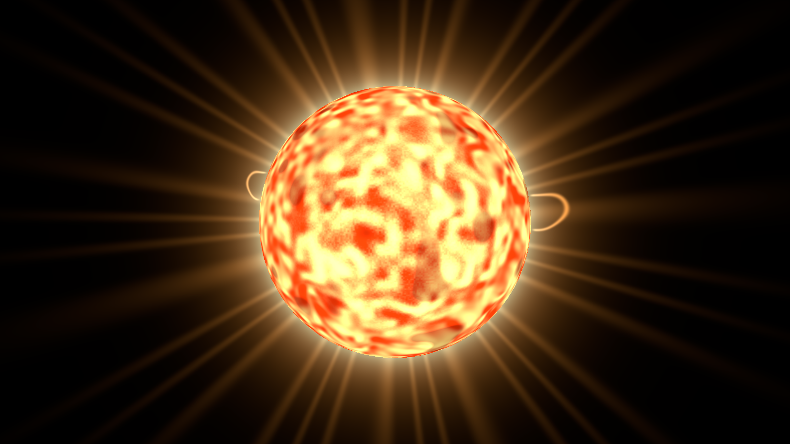
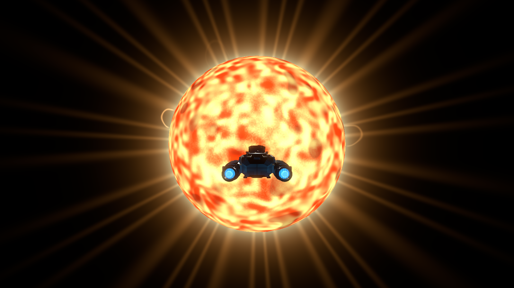
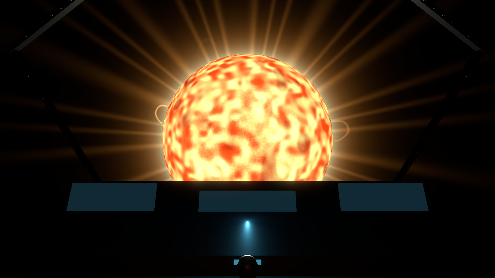
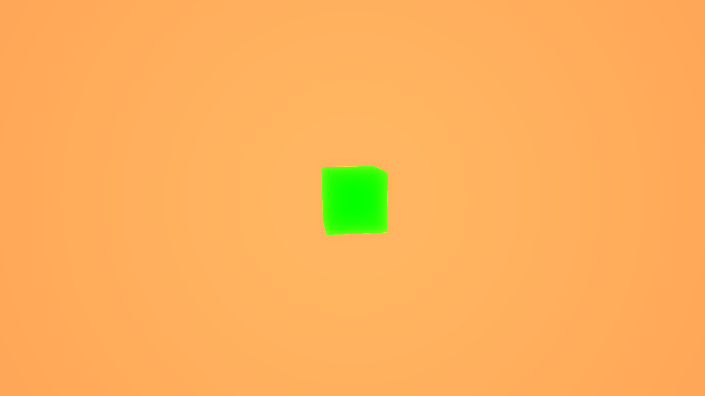

# Звезда, музыка и расстояния: проверка 009

2026-11-03, ветка `fix/star-rendering-and-music`.
Linux/Debian, .NET 10, Godot 4.7.2 .NET, Forward+, Radeon RX 580 2048SP
(RADV POLARIS10), 1600×900, MSAA 4× в тесте звезды.

## Что исправлено

- Неиспользуемый `star.gdshader` подключён к реальной фотосфере Vesper и доработан:
  3D-грануляция, пятна, пульсация, живой рисунок и затемнение края.
- Вместо статичного ореола — собственный анимированный шейдер короны с лучами
  и дугами плазмы. Эффект виден без bloom, High добавляет общее свечение.
- Убрано искусственное увеличение диска в три раза. Аналитическое пересечение
  луча с физической сферой сохраняет угловой размер издалека и вблизи, не расширяя
  frustum камеры до размеров звезды. Учтены отступ камеры от корабля и render origin.
  Серверные радиус, коллизия, варп и полёт не изменены.
- Все 20 MP3 включены в плейлист и репозиторий. Раньше две записи были перечислены
  в коде, а остальные 18 исключались `.gitignore`. Список теперь получается из
  импортированных ресурсов, сортируется по имени и повторяется только после конца.
  Проверка запуска охватывает все музыкальные ресурсы.
- От 0,5 а.е. навигация показывает а.е.; ниже — млн км, тыс. км, км или метры.
  Например: `49,89 млн км`, `0,50 а.е.`, `1,0 тыс. км`. Русские числа с запятой,
  английские — с точкой. Одно форматирование используется списком и картой.

## Проверки

```bash
dotnet build
dotnet build client/IndifferentStars.Client.csproj
godot-dotnet --headless --path client --editor --import --quit
godot-dotnet --headless --path client --script res://tools/verify_resources.gd -- --record
tools/tests/check-client-startup.sh
godot-dotnet --path client --resolution 1600x900 res://tests/StarMusicChecks.tscn
```

Сборки: 0 ошибок/предупреждений. Импорт завершён; независимая проверка ресурсов
подтвердила модели, все музыкальные импорты, сцену и C#-клиент. Проверка запуска:
11/11 сценариев, включая кэш, первый импорт и отказы.

StarMusicChecks: PASS. Проверены привязка шейдеров, видимость с 1 а.е. и в 1 км
над поверхностью, физический диаметр диска по изображению (допуск 5 пикселей),
полюс, отсутствие звезды за спиной, закрытие непрозрачным объектом и ограниченный
frustum. Отдельные кадры короны подтверждают видимость и изменение её рисунка;
изменение поверхности также проверяется по пикселям. Кадры внешнего корабля и
кокпита просмотрены. Low не требует bloom для видимости поверхности и короны.

Музыка: все 20 ресурсов успешно загружаются как AudioStreamMP3 с положительной
длительностью и выключенной петлёй отдельной записи. Проверен переход Finished
через все 20 позиций и возврат к первой (Finished вызывался тестом); смена музыкального каталога не прерывает
текущую запись. Дополнительно все MP3 полностью декодированы ffmpeg без ошибок.
Это проверка целостности/последовательности; все записи целиком вручную не прослушивались.

```bash
dotnet test tests/IndifferentStars.Tests --filter 'FullyQualifiedName~RenderFrameTests|FullyQualifiedName~SurfaceNavigationTests|FullyQualifiedName~WarpSafetyTests|FullyQualifiedName~ProtocolTests'
```

Серверные проверки: **49/49**, 9 мин 18 с; включая 36 000 шагов получасового
полёта, безопасность варпа, координаты/навигацию и протокол.

С отдельным headless-сервером на порту 17874 выполнен NavigationInterfaceChecks:
PASS — поиск, Tab/G, маршрут, меню, модальность и F1/F2/F3. NavigationChecks:
PASS — прежнее положение у планеты, масштаб колец/системы и кокпит после rebase.
В журналах итоговых клиентских сцен, импорта и проверки ресурсов нет ошибок Godot.
LSP-инструменты в сессии отсутствуют; диагностика C# выполнена компилятором.

## Кадры и анимация

| Фотосфера и корона | Без bloom |
| --- | --- |
|  |  |

| Корабль перед звездой | Кокпит |
| --- | --- |
|  |  |



[Анимация поверхности и короны](media/star/motion.mp4): 12 кадров с шагом времени
шейдера 0,5 с; последовательность собрана в MP4 с частотой 2 кадра/с.
Это иллюстрация анимации, не запись измерения FPS.

## Измерение и ограничения

В изолированном тесте при вертикальной синхронизации собраны 180/181 кадров за
3 с на состояние. p95 времени кадра: звезда скрыта — 16,716 мс,
видима — 16,667 мс. Условия: Forward+, 1600×900, MSAA 4×, RX 580 2048SP,
звезда на расстоянии трёх радиусов, планета скрыта, без NPC/станции.
Разница ниже ограничения развёртки; это не доказательство максимального FPS
и не полный игровой нагрузочный тест.

Глубина звезды ограничена 150 км в локальном рендере; физическая сфера и видимый
угловой размер при этом сохраняются. Эффекты короны декоративны: не добавлены
нагрев, урон, магнитная симуляция или новый тип объектов. Музыкальный порядок
последовательный, без новой системы адаптивной музыки; пользовательская папка
по-прежнему заменяет встроенный список. Windows/экспорт готового пакета не проверялись;
использован API ResourceLoader, поддерживающий исходные имена после экспорта.
Художественная приёмка владельцем остаётся открытой.

Следующий предлагаемый шаг — оценить звезду в обычном полёте и при необходимости
отдельно настроить яркость/характер плазмы по художественной обратной связи.
