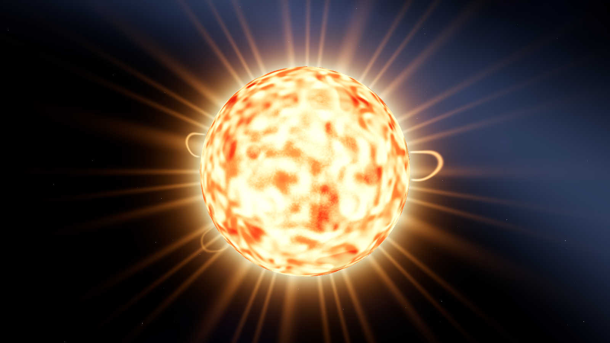
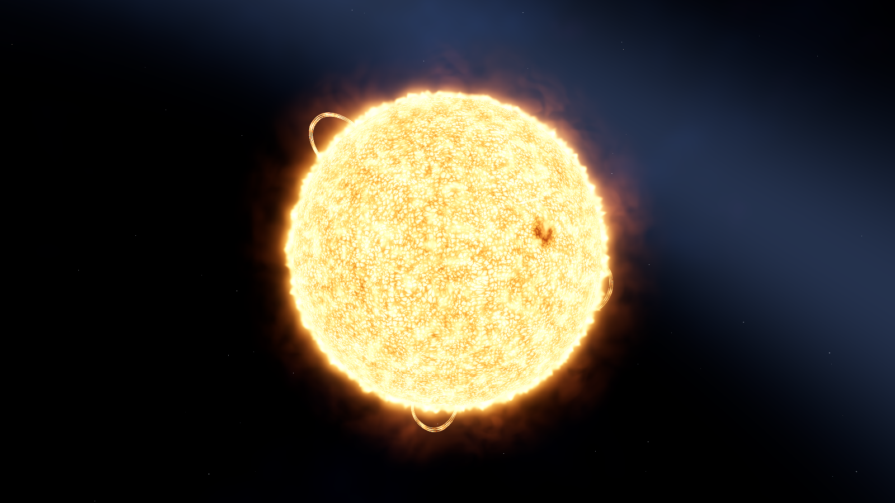
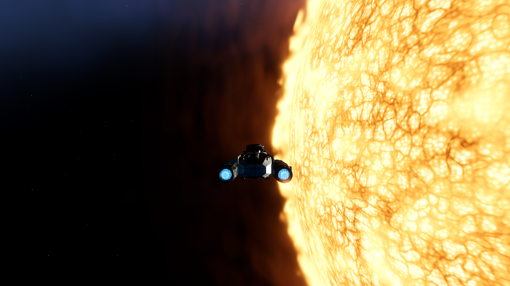
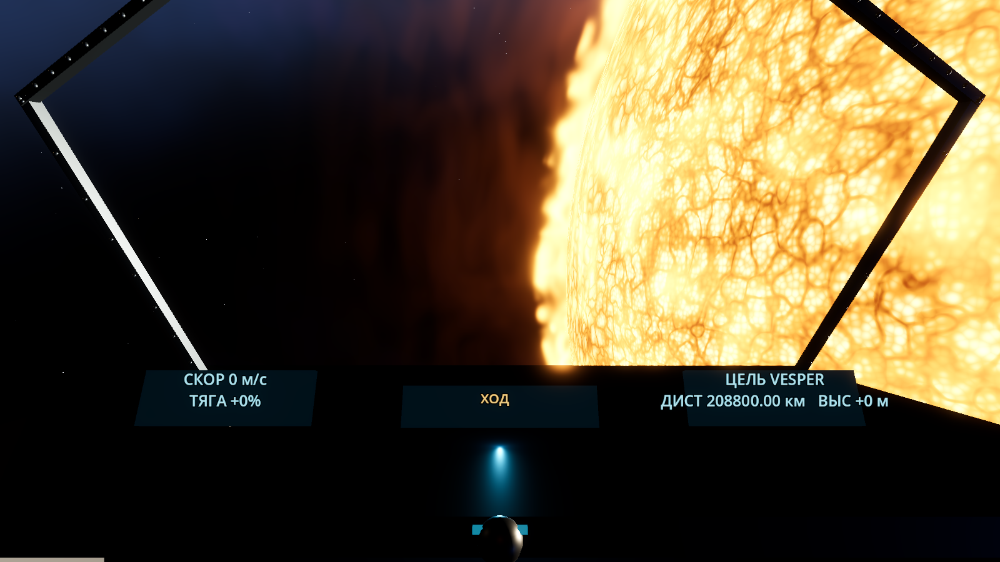
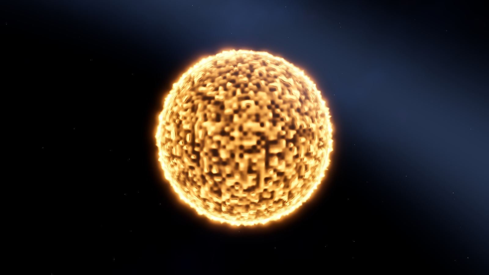
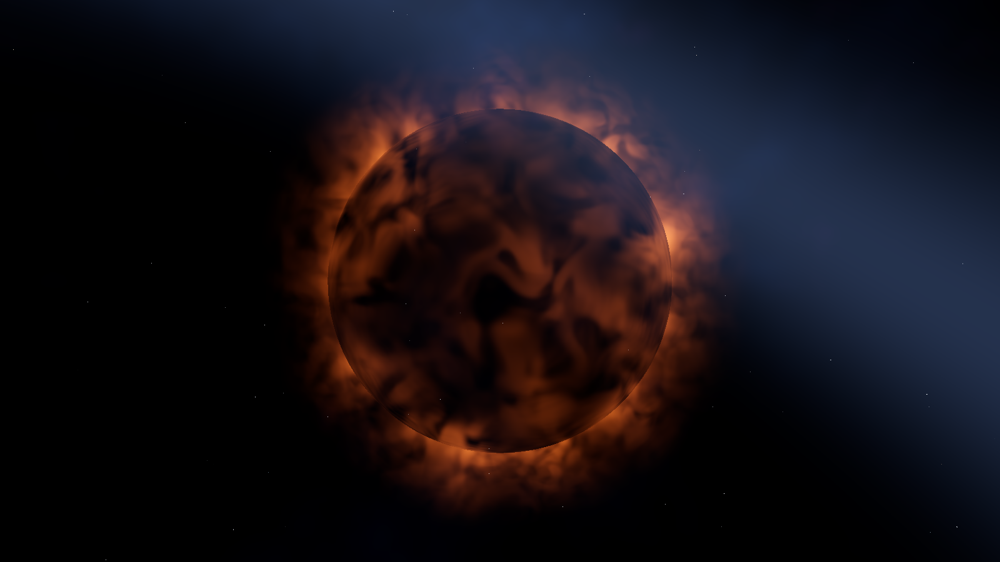
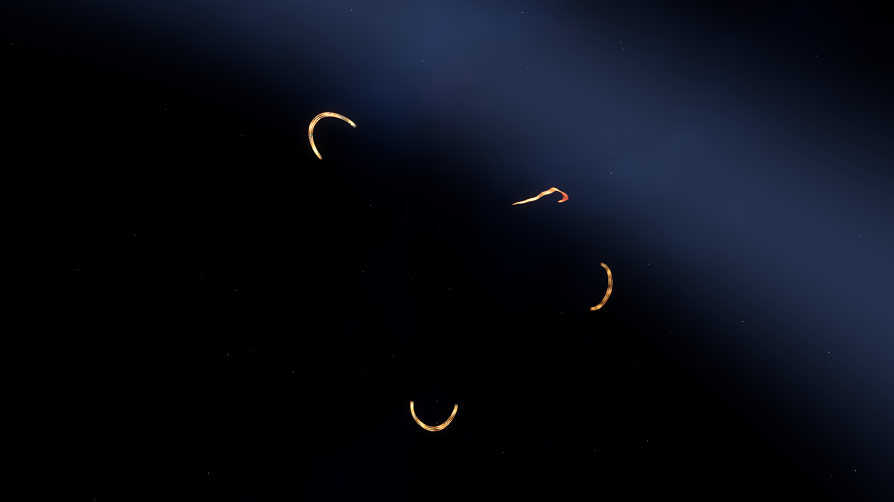

# Vesper: многослойная плазма — проверка 010

2026-11-03. Ветка `feat/vesper-plasma-layers`, исходная версия — `ef6c6f4`.

## Результат и границы

Фотосфера имеет два масштаба конвективных ячеек, горячие ядра/тёмные каналы,
доменную адвекцию, активную область и ближнюю детализацию. Хромосфера создаёт
неоднородный по высоте/яркости эмиссионный край. Корона интегрируется в трёхмерной
оболочке, без прямых экранных лучей. Четыре пространственные арки состоят из
трёх струящихся нитей каждая: при облёте меняются перспектива и перекрытие телом.

Усиление мирового источника света зависит от расстояния, отдельно работает
плавная адаптация ACES-экспозиции. При повороте камеры энергия света не меняется.
Внутри короны объём не исчезает при взгляде наружу; глубина непрозрачной сцены
защищает корпус и кокпит от наложения всего объёма поверх них. Low использует
6 шагов вместо 12, оставаясь читаемым без bloom. Протуберанцы — 9216 треугольников.

Физический радиус/силуэт фотосферы, авторитетные коллизии, варп и протокол не
изменены. Хромосфера/корона декоративны. Нагрев, урон и научная модель плазмы
не добавлялись. Художественная приёмка владельцем остаётся открытой.

## До и после

Одинаковые seed 20261101, разрешение 1600×900, FOV 60°, расстояние 3 R,
время материала 12 с. Экспозиция и освещение изменены намеренно как часть задачи.

| Было | Стало |
| --- | --- |
|  |  |

| Приближение с кораблём | Кокпит |
| --- | --- |
|  |  |

| Хромосфера отдельно | Корона отдельно | Пространственные нити |
| --- | --- | --- |
|  |  |  |

[Анимация плазмы](media/vesper/plasma-motion.mp4): неподвижная камера, 32 кадра,
шаг времени 0,12 с. [Диагностический облёт](media/vesper/orbit.mp4): 32 ракурса
на протяжении 44,4°, время плазмы фиксировано. Это управляемые тестовые кадры,
не запись серверного перемещения корабля.

## Измерение стоимости

CPU Intel Xeon E5-2680 v4, GPU Radeon RX 580 2048SP / RADV POLARIS10,
Godot 4.7.2 .NET, Vulkan Forward+, 1600×900, RenderScale=1, MSAA 2×.
VSync выключен, ограничение FPS отключено. Измеряется реальный интервал между
кадрами по монотонным часам, не сглаженный delta. На состояние — 1,5–2 с после
прогрева; число кадров и медианы сохранены в исходных JSON.

В сценарии нет NPC и сетевой симуляции: станция/астероиды находятся далеко от
камеры и отсекаются, корабль/кокпит добавляются только для отдельных кадров.
Это стоимость рендера звезды в контрольной сцене, не обещание общего игрового FPS.
Эффект дороже прежнего: общий план добавляет около 3 мс, подробный вид края —
около 7 мс на этой системе. Измеренные состояния остаются внутри 16,7 мс, но
запас зависит от остальных видимых объектов/настроек и фоновой нагрузки.

| Положение | Было p95, мс | Стало p95, мс |
| --- | ---: | ---: |
| 3 R, общий план | 3.952 | 6.824 |
| 1,3 R, край в поле зрения | 3.586 | 10.587 |
| 1 км над поверхностью, горизонт | 3.421 | 8.254 |
| 1 км, взгляд на фотосферу | 3.211 | 4.568 |

Low на общем плане: p95 **4.875 мс**, без bloom, 6 шагов объёма.

[Исходные измерения до](media/vesper/baseline-telemetry.json),
[после](media/vesper/candidate-telemetry.json),
[журнал до](media/vesper/baseline-run.txt),
[после](media/vesper/candidate-run.txt).
Проверяемые хеши материалов, сценария и выбранных артефактов:
[manifest.json](media/vesper/manifest.json).

## Проверки и воспроизведение

```bash
dotnet build
dotnet build client/IndifferentStars.Client.csproj
dotnet test tests/IndifferentStars.Tests --filter 'FullyQualifiedName~RenderFrameTests|FullyQualifiedName~WarpSafetyTests|FullyQualifiedName~ProtocolTests'
godot-dotnet --headless --path client --editor --import --quit
godot-dotnet --headless --path client --script res://tools/verify_resources.gd -- --record
IS_VESPER_CAPTURE=/tmp/vesper-check godot-dotnet --path client --resolution 1600x900 res://tests/VesperVisualChecks.tscn
godot-dotnet --path client --resolution 1600x900 res://tests/StarMusicChecks.tscn
```

- Обе сборки: 0 ошибок/предупреждений; серверные регрессии **47/47**.
- Импорт и независимая загрузка ресурсов: PASS.
- VesperVisualChecks: PASS. Раздельная видимость слоёв, пространственные нити,
  дальний/ближний вид, Low, облёт, постоянство энергии света при повороте и
  отсутствие скачка экспозиции, замеры в четырёх положениях.
- StarMusicChecks: PASS. Физический диаметр, 1 а.е./3 R/1 км, полюс,
  анимация, перекрытие передними объектами, ограниченный frustum; музыка 20/20.
- NavigationInterfaceChecks с отдельным headless-сервером на порту 17876: PASS,
  включая F1/F2/F3, поиск, Tab/G, маршрут, общие действия и модальное окно.
- В итоговых журналах GPU-сцен, импорта и проверки ресурсов нет ошибок Godot.

Адаптера `.game-dev` и CLI `game-dev` в окружении нет; использованы проектные
сцены Godot с детерминированными кадрами и телеметрией. Эти материалы не выдаются
за запечатанный прогон внешнего harness. LSP-инструменты не предоставлены;
диагностика C# выполнена компилятором. Windows и экспорт пакета не проверялись.

Следующий предлагаемый этап — художественная оценка кадров/облёта владельцем
и отдельная настройка характера активности по этой обратной связи.
