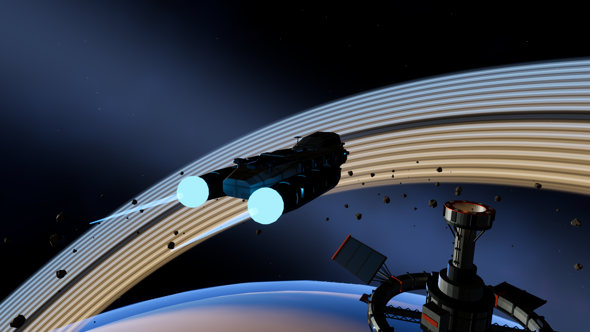
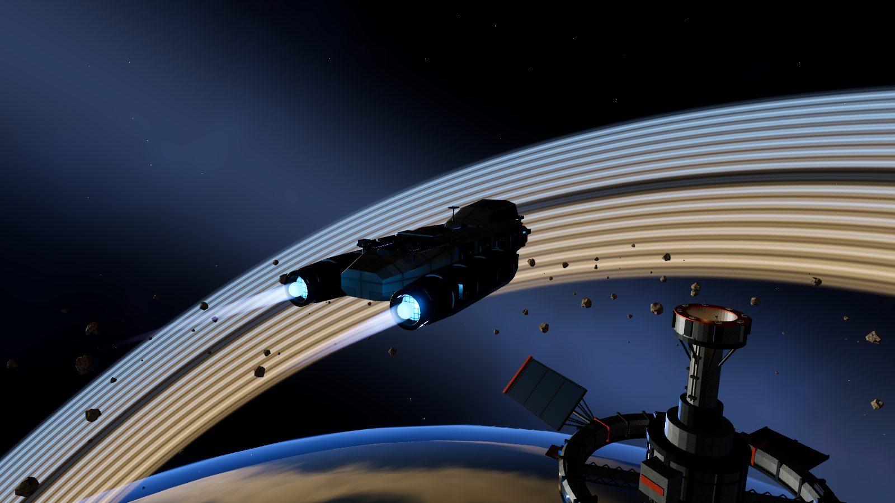
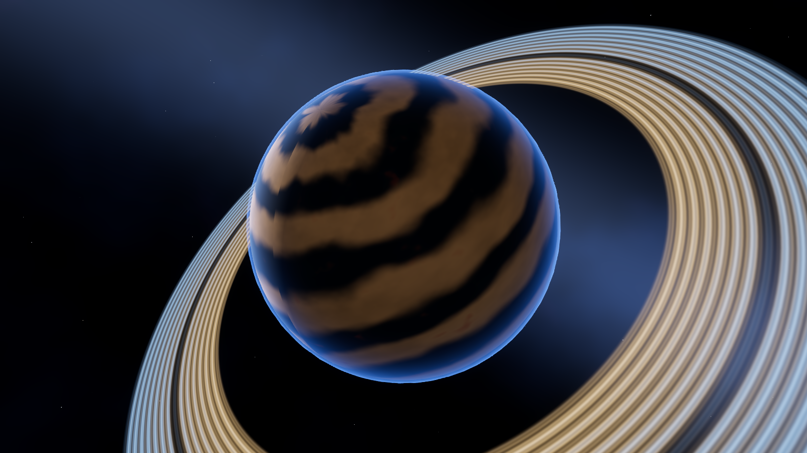
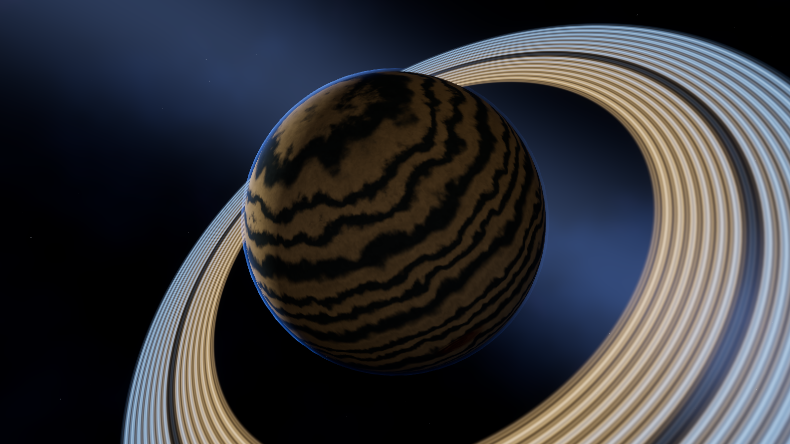
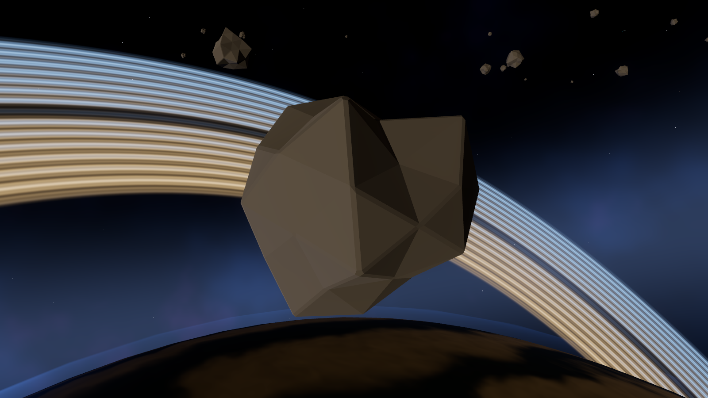
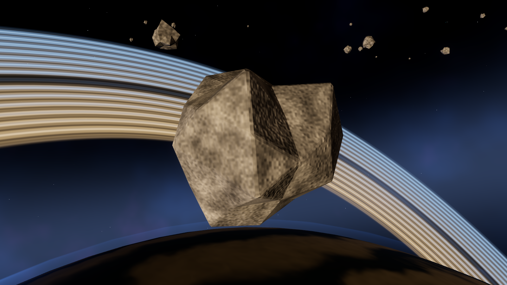

# Зум, струи и материалы космоса — 006

Реализация задания [006](tasks/006-visual-polish.md) поверх Wren (005).
Инженерная проверка и художественная оценка владельца — отдельные результаты.

## Поведение

- Колесо в F2 плавно меняет дистанцию **24–650 м**; шаг цели ×/÷1,15,
  сглаживание 10/с. Alt/средняя кнопка сохраняют обзор. Ориентация плеча
  сглаживается Slerp 7,5/с: резкий полуоборот проходит по дуге с постоянным радиусом.
- F1, кокпит и открытое меню не меняют внешнюю дистанцию. F1/F2/F3 сохраняют
  ракурс/зум; место глаз кокпита, сенсоры и полётные правила не меняются.
  24 м оставляют камеру вне корпуса и при декоративном растяжении ×1,8 в варпе.
  650 м дают небольшой корабль на фоне станции, не обзор системы.
- Струи получили голубое ядро, сине-фиолетовую периферию, мягкий край и конец,
  небольшие волны по длине/времени. Свечение уменьшено до размера внутри сопла.
  Обычная тяга, форсаж и маневровые/тормозные импульсы различаются длиной и портами;
  изменение плавно следует существующим серверным снимкам. Точки GLB и мировой
  IonTrail сохранены; варп сбрасывает историю, кокпит скрывает собственный выхлоп.
- Aster Reach использует объёмный шум, искажённые полосы, локальные вихри и мелкие
  облачные структуры. Координаты — нормализованное локальное направление сферы,
  без UV-долготы. Частоты фильтруются экранными производными. Блик ослаблен,
  атмосфера стала тоньше и затухает на ночной стороне по направлению звезды.
- Астероиды получили собственный каменный материал: минеральная неоднородность,
  слоистость, зерно, высокий roughness и небольшой рельеф нормалей.
  Геометрия GLB и коллизии остались прежними; новые типы объектов не добавлены.
- Убрана устаревшая фраза RU/EN о необходимости разгона для варпа из подсказки
  крейсерского режима. Его собственное правило свободной зоны 10 км сохранено.

Источники шейдеров — `client/assets/shaders/{exhaust,planet,atmosphere,rock}.gdshader`.
Сторонних моделей, текстур, сервисов или зависимостей нет.

## Воспроизведение

Из корня проекта, с установленным Godot .NET:

```bash
GODOT_BIN="$GODOT_BIN" tools/tests/check-surfaces-and-warp.sh
IS_POLISH_CAPTURE=/tmp/polish IS_POLISH_MOVIE=1 \
  "$GODOT_BIN" --path client res://tests/VisualPolishChecks.tscn \
  --resolution 1600x900 --audio-driver Dummy
IS_POLISH_CAPTURE=/tmp/polish IS_POLISH_PLANET_MOVIE=1 \
  "$GODOT_BIN" --path client res://tests/VisualPolishChecks.tscn \
  --resolution 1600x900 --audio-driver Dummy -- --planet-only
```

В обычной игре: `tools/run-local.sh`, F2, колесо и Alt/средняя кнопка.
После смены ветки/ассетов перезапустить сервер и клиент.

`VisualPolishChecks` — художественный стенд с заданными образцами снимков:
он фиксирует геометрию, камеру, свет, экспозицию и качество для сравнения состояний.
Он не доказывает сетевое управление. Это отдельно проверяют CameraChecks,
CompletionChecks и WarpChecks с настоящим сервером и обычными намерениями клиента.

## Проверки

Полный `check-surfaces-and-warp.sh`: Release build, 107/107 тестов без пропусков,
Godot import, SurfaceGeometry/ShipTrack/Effects/Navigation/SurfaceFlight,
два независимых UDP-клиента в WarpChecks и графический CameraChecks.
Сборки клиента/сервера — без ошибок и предупреждений; тесты — 32 с.

- EffectsChecks: мировой след, origin shift, поворот корпуса, исчезновение следа,
  варп, нужные маневровые порты, плавное угасание тяги, скрытие в кокпите и отключение эффектов.
  Дополнительный red/green-тест подтвердил сброс сглаженного маневрового импульса:
  после выхода из варпа старый импульс не проигрывается повторно.
- CameraChecks: настоящие события колеса/средней кнопки, пределы зума и безопасная
  дуга, меню, F1/F2/F3, место глаз, выход от станции обычной тягой, варп в свободное
  пространство, крейсерский ход и зум при переносе начала координат.
- WarpChecks: 650 м при зарядке и переключениях, 24 м на AU-переходе,
  все стадии/представления, серверный маршрут, прибытие с запасом 1 км.
  Измерено 609 кадров варпа, p95 20,48 мс, 1600×900, scale 1, MSAA 2×.
- CompletionChecks: Alt и средняя кнопка, отсутствие поворота корабля от обзора,
  взгляд из кокпита, возврат вперёд и заклёпки рамы.

## Сравнение и ограничения

Кадры до/после выхлопа и дальнего/ближнего вида планеты используют одинаковые
позиции, seed 20261101, свет, экспозицию 0,95 и качество. Фаза TIME/мелкой
пульсации не заморожена: это сопоставимые сцены, не попиксельный эталон.
Дневной/полярный вид и полный оборот дополняют сравнение планеты.
Для камня исходный материал GLB и новый шейдер сняты одним стендом с одной камерой.

Условия замера: Xeon E5-2680 v4, RX 580 2048SP 8 GB, RADV/Vulkan Forward+,
Godot 4.7.2 .NET, 1600×900, scale 1, MSAA 4×, VSync; игрок и 8 NPC,
380 астероидов. Один графический процесс за раз, 1 с прогрева + 5 с измерения.
Контроль Low отключает bloom, тени и детальный sky, сохраняя разрешение/MSAA;
это не весь пользовательский preset Low. Замеряется время между кадрами,
а не отдельное GPU-время. Учёт памяти Godot не включает весь драйвер.

| Сцена | До | После |
| --- | --- | --- |
| High, 300 кадров | p95 20,382 мс | p95 20,351 мс |
| Low, 300 кадров | p95 20,450 мс | p95 20,080 мс |
| Draw calls High / Low | 46 / 30 | 46 / 30 |
| Память видео, байт | 487 771 668 | 487 880 100 |
| Память текстур, байт | 427 020 868 | 427 020 868 |

Изменение p95 находится в пределах вариации короткого оконного прогона;
это подтверждает отсутствие наблюдаемой регрессии в выбранной сцене,
не доказывает предельный FPS. Рост учтённой памяти — 108 432 байта,
объём текстур не вырос. [Сырые результаты](performance/polish-2026-11-03/).

| До | После |
| --- | --- |
|  |  |
|  |  |
|  |  |

[Зум 24 м](media/polish/zoom_near.png), [650 м](media/polish/zoom_far.png),
[Low без bloom](media/polish/after/low_boost.png),
[эффекты отключены](media/polish/after/effects_off.png),
[дневная сторона](media/polish/after/planet_day.png),
[полярный вид](media/polish/after/planet_pole.png).

Записи: [струи](media/polish/exhaust-motion.mp4),
[полный оборот планеты](media/polish/planet-orbit.mp4),
[зум на крейсерском ходу](media/polish/zoom-cruise.mp4).
Это последовательности кадров стенда (12 кадров/с), не измерение частоты игрового вывода.
Просмотрены противоположные долготы и полюс; видимого UV-шва или полярного растяжения
не обнаружено. Проверка не гарантирует отсутствие мерцания при всех возможных дистанциях.

Геометрия астероидов сохраняет прежнюю гранёную форму; этот этап меняет их материал.
Художественная оценка владельца остаётся открытой.
Следующий разумный шаг — оценка этих кадров и короткий игровой просмотр владельцем.
Новых этапов и релиза этот отчёт не запускает.
